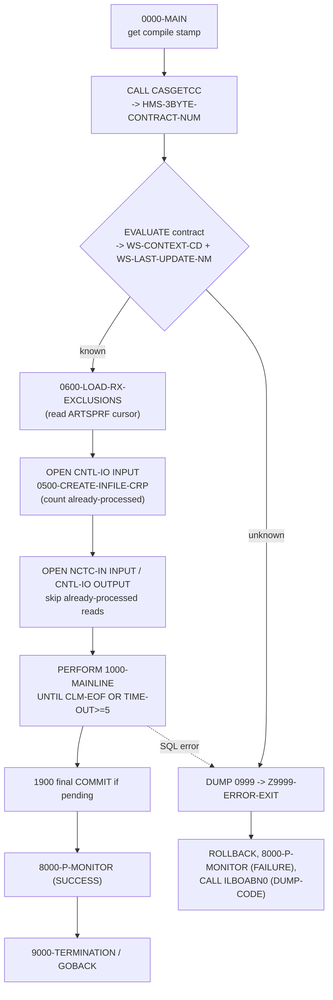
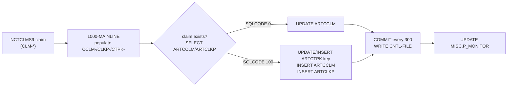
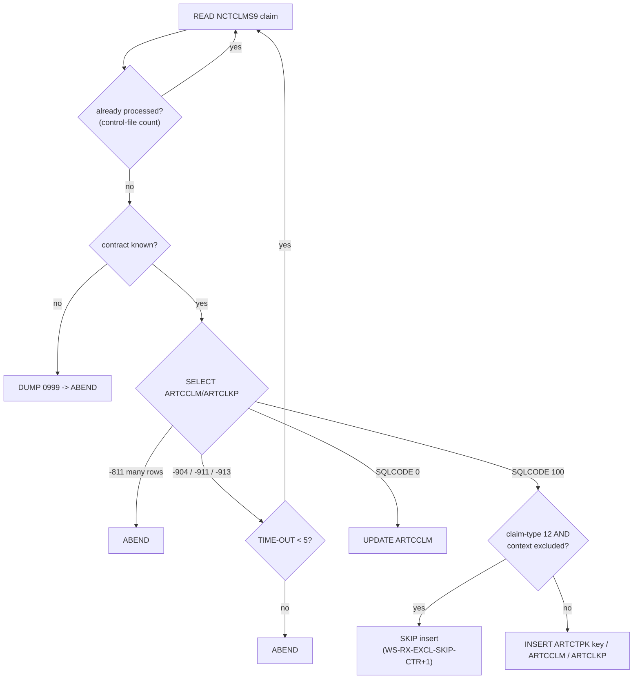

# CASNCTD9 — Comprehensive COBOL Field-Mapping Analysis

> **Companion workbook:** [`CASNCTD9_1x1_Field_Mapping.xlsx`](CASNCTD9_1x1_Field_Mapping.xlsx)
> (4 sheets — Field Mapping, Overrides & Crosswalks, Routing / Format Logic, Sample Records).
> **Generator:** [`generate_field_mapping.py`](generate_field_mapping.py) (openpyxl).
> **Program source analysed:** [`CASNCTD9_Version2.txt`](CASNCTD9_Version2.txt) (1,578 lines).
> All line numbers below refer to that source file.

---

## ⚠️ Note on program/deliverable naming

The reusable prompt was filled with **placeholder names that do not exist in this
repository**:

| Prompt value | Status in repo |
|---|---|
| Program `CASPCFAL.txt` | **Not found** anywhere in git history |
| Output prefix `CASNCTAL` | **Not found** — leftover placeholder |
| **`CASNCTD9_Version2.txt`** (PROGRAM-ID `CASNCTD9`) | **The only COBOL source ever committed** |

A full scan of the git object database returns exactly one COBOL blob —
`CASNCTD9_Version2.txt` (it had been deleted in PR #1 and was restored to the repo
root so every citation here is verifiable). This analysis therefore documents the
**real** program, `CASNCTD9`, and names the deliverables after it
(`CASNCTD9_1x1_Field_Mapping.xlsx`, `CASNCTD9-Comprehensive-Analysis.md`). If you
intended a different program, please add it and re-run the generator.

---

## 1. Overview and purpose

`CASNCTD9` is a **batch DB2 loader**. It reads the *current GDG* of the PCFCASE
claims extract (the “NCTCLMS 300/316 file”) and, for each claim, **inserts or
updates** rows in three DB2 tables in the HMS Case-Tracking schema, maintaining a
restart-safe control file and a process-monitor heartbeat along the way
(lines 6-13, 271-377).

* **Program role:** **Reformat + Multi-output.** The input record layout
  (`NCTCLMS9`) is *different* from every output layout (the DB2 DCLGENs), and the
  program writes **more than one** output (three DB2 tables + a control file +
  the `MISC.P_MONITOR` table). It is **not** a passthrough or a simple
  filter/splitter.
* **Bulk-move length:** none. There is **no** whole-record `MOVE`; every field is
  populated individually (mostly via `UNSTRING` into DB2 `VARCHAR` host variables),
  so there is no single bulk-copy length to report.
* **Lineage:** cloned from `CASNCTD2`/`CASNCTD7` for NY; the newest changes (0027,
  0028) add `RX_WRITTEN_DT` population and NY RX-encounter exclusion (lines 30-63).

## 2. Inputs reviewed

| Artifact | Kind | In repo? | Notes |
|---|---|---|---|
| `CASNCTD9_Version2.txt` | COBOL program | ✅ (restored) | PROGRAM-ID `CASNCTD9` (line 2) |
| `NCTCLMS9` | Input copybook, prefix `CLM-` | ❌ external `COPY` | `COPY NCTCLMS9 REPLACING ==(PREFIX)== BY ==CLM==` (line 92) |
| `ARTCCLM` | DB2 DCLGEN (claim table) | ❌ external `INCLUDE` | line 243 |
| `ARTCLKP` | DB2 DCLGEN (claim lookup) | ❌ external `INCLUDE` | line 245 |
| `CARTCTPK` | DB2 DCLGEN (primary-key table) | ❌ external `INCLUDE` | line 241 |
| `ARTSPRF` | DB2 DCLGEN (preferences) | ❌ external `INCLUDE` | line 248 |
| `PMONITOR` | DB2 DCLGEN (process monitor) | ❌ external `INCLUDE` | line 251 |
| `SQLCA` | DB2 communication area | ❌ external `INCLUDE` | line 238 |
| Control file (`DB2CNTLO`) | Flat checkpoint file | n/a (runtime) | `CNTL-RECORD PIC X(38)` (line 100) |

Because the copybooks/DCLGENs are **external includes not present in the repo**,
exact PIC clauses, `VARCHAR` lengths and byte offsets of copybook/host-variable
fields cannot be read from source. They are marked **`[inf]`** (inferred from how
the code uses them) and sample values are marked *illustrative*. The only flat
record defined inline — `WS-CONTROL-RECORD` (lines 183-188) — has **real** byte
offsets.

## 3. Program architecture and flow

Mainline loop (`1000-MAINLINE`, lines 490-836): `INITIALIZE` the three DCLGEN
areas → derive the context code → populate every ARTCCLM host variable → probe for
an existing claim → branch to **UPDATE** or **INSERT** → periodic `COMMIT` → read
next record.

## 4. Layout and copybook relationship

* **Input → output layouts differ** (reformat). Input fields carry the `CLM-`
  prefix (from `NCTCLMS9`); outputs are DB2 columns whose host variables carry the
  DCLGEN prefixes `CCLM-` (ARTCCLM), `CLKP-` (ARTCLKP) and `CTPK-` (ARTCTPK).
* Most outputs are DB2 **`VARCHAR`** host variables, which in DCLGEN are a group of
  a length half-word (`-LEN`/`-L`, `PIC S9(4) COMP`) plus a text item (`-TEXT`/`-T`,
  `PIC X(n)`). The program populates them almost exclusively with `UNSTRING …
  DELIMITED BY ALL SPACES … COUNT IN …`, which trims trailing spaces and sets the
  correct length (e.g., lines 605-608, 629-642, 650-658).
* `INITIALIZE DCLARTCTPK DCLARTCCLM DCLARTCLKP` (line 491) clears all three output
  areas at the top of every record, so any field left untouched defaults to its
  initialized value (SPACES / ZEROES per item type).

## 5. Input formats

A **single** input record format:

* **`NCTC-IN`** — DD `NCTCLMI`, `COPY NCTCLMS9` (prefix `CLM-`), `RECORDING MODE F`,
  `RECORD CONTAINS 316 CHARACTERS` (lines 85-92).

The 23 `CLM-` elementary fields actually referenced by the program are enumerated
in Sheet 1 (Source Field column) and Sheet 4 (full sample). The control file
(`CNTL-IO`, DD `DB2CNTLO`) is a second physical input used only for **restart
accounting** and is also an output (I/O file).

## 6. Output layouts and write paths

| # | Output target | Operation(s) | Where | Fields |
|---|---|---|---|---|
| 1 | **ARTCCLM** (claim) | `UPDATE` (23 SET cols) / `INSERT` (27 cols) | 851-883 / 1035-1101 | 27 active (+2 commented) |
| 2 | **ARTCLKP** (claim lookup) | `INSERT` (7 cols) | 1179-1200 | 7 active (+2 commented) |
| 3 | **ARTCTPK** (primary key) | `UPDATE` (incr) / `INSERT` (seed) | 932-938 / 1233-1250 | 7 |
| 4 | **MISC.P_MONITOR** | `UPDATE` (per context) | 1333-1430 | 4 set columns |
| 5 | **CNTL-FILE** (`DB2CNTLO`) | `WRITE` at each COMMIT | 1304 | 4 (flat X(38)) |

Each input claim produces **either** one ARTCCLM `UPDATE` **or** one ARTCCLM
`INSERT` + one ARTCLKP `INSERT` (+ ARTCTPK key maintenance). See the decision tree
in §12.

## 7. Mapping methodology

For every **output** field (one Sheet-1 row each) the source was traced to the
elementary level through the procedure division, resolving working-storage
intermediaries (e.g., `WS-CONTEXT-CD`, `WS-DE-EDIT`, `WK-DIAG-CODE`) and loop
subscripts (`WS-RX-EXCL-CONTEXT-CD(idx)`). Each field is then classified as exactly
one of: **1x1 identity**, **direct MOVE (renamed)**, **derived/transformed**,
**crosswalk/translated**, **hardcoded constant**, **default SPACES/ZEROS**, or
**not populated**. Counts across the 53 output fields:

| Classification | Count |
|---|---|
| derived/transformed | 16 |
| direct MOVE (renamed) | 12 |
| hardcoded constant | 12 |
| crosswalk/translated | 8 |
| not populated | 4 |
| default SPACES/ZEROS `[UNCERTAIN]` | 1 |
| 1x1 identity | 0 |
| **Total** | **53** |

There are **no** pure 1x1-identity fields because the record is never bulk-moved;
even “direct” values pass through `UNSTRING`/rename into differently named DB2
columns.

## 8. Field-level behavior (base rules + per-path overrides)

**Base rule (ARTCCLM).** Populate `CCLM-*` host variables from `CLM-*` inputs, then
`UPDATE` the existing row or `INSERT` a new one with the same values plus a
generated `CLAIM_ID` and `LAST_UPDATE_DTM = CURRENT TIMESTAMP`.

Per-path specifics:

* **ARTCCLM UPDATE** (851-883) sets 23 business columns but **not** `CONTEXT_CD`,
  `CLAIM_ID`, `ICN_NUM` (those are the `WHERE` key, lines 880-882).
* **ARTCCLM INSERT** (1035-1101) writes all 27 active columns including the key.
* **ARTCLKP** is written **only** on the INSERT path, sharing `CONTEXT_CD` and the
  generated `CLAIM_ID`, with constant `RELATE_IND='0'` and `IS_AUTO_CHECKED='N'`.
* **ARTCTPK** is a per-context sequence row: `UPDATE … PK_NEXT_NUM = PK_NEXT_NUM+1`
  (933), or a seed `INSERT` with `PK_NEXT_NUM=+2` the first time a context appears
  (1246).
* **MISC.P_MONITOR** is updated once per distinct context with that context’s
  committed row count.

The complete, per-field table (picture, byte location, mapping type, source,
sample in/out, owning output, evidence line) is **Sheet 1** of the workbook.

## 9. Initialization and defaulting (SPACES, ZEROS, constants)

* `INITIALIZE DCLARTCTPK DCLARTCCLM DCLARTCLKP` (491) resets all output areas each
  record; untouched items default to SPACES (alphanumeric) or ZERO (numeric).
* **Hardcoded constants:** `RELATE_IND='0'` (1193), `IS_AUTO_CHECKED='N'` (1196),
  `PK_TYPE_CD='CLM'` (1243), `PK_DSC='CASE TRACKING SYSTEM CLAIM'` (1244),
  `PK_NEXT_NUM=+2` seed (1246), `TASK_STEP_TXT='LOAD'` (1335), and every
  `LAST_UPDATE_DTM`/`END_DTM = CURRENT TIMESTAMP`.
* **Control record constants:** `CNTL-PROC-FLAG='-'` (185/1301) and `FILLER='++'`
  (187).
* **Conditional defaults:** `ALT_CLIENT_CD` ← SPACES unless contract `535` (776);
  `RX_WRITTEN_DT` ← NULL (indicator −1) when the input date is blank/zero/low-values
  (845-846).
* **Not populated:** `CREATE_NM`/`CREATE_DTM` in both ARTCCLM and ARTCLKP are
  **commented out** (1065-1066, 1098-1099, 1187-1188, 1197-1198) — listed in Sheet 1
  so no output field is dropped.

## 10. Transformation and crosswalk logic

All crosswalks and overrides are catalogued in **Sheet 2**. Highlights:

* **Context code** — two-stage crosswalk: contract number → base context
  (`320→CTSCASNY`, `313→CTSCASFL`, …, 299-330), then for NY (320) and FL (313) a
  second `EVALUATE CLM-HMS-CLIENT-ID` refines it (e.g., `CTSCCN→CTSCASNYC`,
  `CTSMST→CTSCASMT-FL`, 512-589). Multi-context clients (326/590/359/645) overlay
  the first 6 bytes of the client id (499-506).
* **`LAST_UPDATE_NM`** — contract → user-id crosswalk (`320→WNYCDF40`, …, 300-325).
* **`CREATE_SOURCE_NM`** — `CLM-CREATE-SOURCE` `00→STANDARD MEDICAID`, `01→DSS`
  (754-759).
* **Dates** — `YYYYMMDD → YYYY-MM-DD` by reference-modification (`REMIT_DT` 665-669;
  `SERVICE_FROM_DT` 671-678; `SERVICE_TO_DT` 680-684).
* **Amounts** — de-edited through `WS-DE-EDIT PIC S9(7)V99` (`CHARGE_AMT` 660-661;
  `PAID_AMT` 662-663).
* **Service code routing** — `CLM-CLAIM-TYPE='12'` (RX) → `NDCCD_RF`; otherwise →
  `ICD9P_RF` truncated to 10 (686-700).
* **Diagnosis normalisation** — strip the `.` from 3-char-root codes and left-shift a
  leading space (`ICD9D_RF` 702-726; `ICD9D_2ND_RF` 728-752).
* **Key generation** — `CLAIM_ID` = `ARTCTPK.PK_NEXT_NUM − 1` after the bump
  (967-1021).

## 11. Dependencies

* **Copybooks / DCLGENs:** `NCTCLMS9`, `ARTCCLM`, `ARTCLKP`, `CARTCTPK`, `ARTSPRF`,
  `PMONITOR`, `SQLCA` (all external — see §2).
* **DB2 objects:** `DB2AR01.ARTCTPK`, `ARTCCLM`, `ARTCLKP`, `CTSPROD.SEC.ARTSPRF`,
  `MISC.P_MONITOR`, `SYSIBM.SYSDUMMY1` (lines 11-28, 262, 1290, 1333).
* **Called programs:** `CASGETCC` (get 3-byte contract, 288), `DSNTIAR` (format SQL
  error, 1558), `ILBOABN0` (abend with `DUMP-CODE`, 1578).
* **DD names:** `NCTCLMI` (input), `DB2CNTLO` (control I/O).

## 12. Skip / reject / stop / abend conditions

* **Skip (restart):** records already counted in the control file are re-read and
  skipped (338-360, 379-411).
* **Skip (RX exclusion):** `CLM-CLAIM-TYPE='12'` and context in the `ARTSPRF`
  exclusion list → ARTCCLM+ARTCLKP INSERT skipped (909-930).
* **Good completion (stop):** empty input / all previously processed → `DUMP-CODE
  0998` (good completion, chg 0011) (346-357).
* **Abend (`DUMP-CODE`, via `ILBOABN0`):** unknown contract or `CASGETCC` RC≠0
  (`0999`, 288-329); `SELECT −811` multiple claim ids (798-803); uncommitted ARTCTPK
  intervention (1011-1018); any unexpected SQLCODE → `Z9999-ERROR-EXIT`; default
  `DUMP-CODE 3645` (104, 1556-1578).
* **Timeout/deadlock retry:** `−904/−911/−913` → `ROLLBACK` + retry up to 5
  (`TIME-OUT-CTR`) then abend (804-818, 363-366).
* **Commit cadence:** every `SQL-COMMIT-FREQ = 300` operations and at EOF
  (110, 828-830, 1276-1313).

## 13. Worked example (sample records)

**Sheet 4** holds the full example. One NY claim (contract `320`, `CLM-HMS-CLIENT-ID
= CTSCCN` → context `CTSCASNYC`, medical claim-type `20`):

| Input (`CLM-`) | Value | → Output | Value |
|---|---|---|---|
| `CLM-ICN` | `0024031500012300` | `ARTCCLM.ICN_NUM` | `0024031500012300` |
| `CLM-CHARGE-AMT` | `+0001250.00` | `ARTCCLM.CHARGE_AMT` | `1250.00` |
| `CLM-DOR-A` | `20240315` | `ARTCCLM.REMIT_DT` | `2024-03-15` |
| `CLM-SVC-CODE` | `99213` | `ARTCCLM.ICD9P_RF` | `99213` |
| `CLM-PRIMARY-DIAG-CODE` | `E11.9` | `ARTCCLM.ICD9D_RF` | `E119` |
| `CLM-CREATE-SOURCE` | `00` | `ARTCCLM.CREATE_SOURCE_NM` | `STANDARD MEDICAID` |
| `CLM-RX-WRITTEN-DATE` | *(spaces)* | `ARTCCLM.RX_WRITTEN_DT` | `NULL` |
| *(generated)* | — | `ARTCCLM.CLAIM_ID` / `ARTCLKP.CLAIM_ID` | `1000001` |
| `CLM-HMS-CASE-KEY` | `CASE0001234567` | `ARTCLKP.CASE_ID` | `CASE0001234567` |

A second illustrative variant in Sheet 4 shows an **RX** claim (`claim-type 12`):
`CLM-SVC-CODE` routes to `NDCCD_RF`, `RX_WRITTEN_DT` is populated, and the INSERT is
skipped when the context is on the NY RX-encounter exclusion list.

## 14. Gaps, assumptions, and risks

1. **Program-name mismatch.** `CASPCFAL.txt`/`CASNCTAL` do not exist; analysis is of
   the only real program, `CASNCTD9`. *(assumption — flagged up top)*
2. **External copybooks absent.** `NCTCLMS9` and all DCLGENs are not in the repo, so
   PIC clauses, `VARCHAR` lengths and input byte offsets are **inferred** (`[inf]`)
   from usage and marked *illustrative*. Exact lengths need the copybooks. *(gap)*
3. **`PK_MASK_TXT` `[UNCERTAIN]`.** The host variable `CTPK-PK-MASK-TXT` is inserted
   (1245) but never `MOVE`d in visible code; its value comes from the DCLGEN default
   after `INITIALIZE` (491). Confirm against `CARTCTPK`. *(uncertain)*
4. **Control-record truncation.** `WS-CONTROL-RECORD` is **40 bytes**
   (1 + 11 + 2 + 26) but `CNTL-RECORD` is `PIC X(38)` (100); `WRITE … FROM` truncates
   the last **2 bytes** of `WS-CURRENT-TIMESTAMP`, so only 24 of 26 timestamp
   characters reach the file. *(risk — verify this is intended)*
5. **Sample values are illustrative**, chosen to satisfy the inferred PIC/length and
   to keep one input consistent with its outputs; they are not production data.
6. **Contract number is environmental**, returned by `CASGETCC` (288), not carried on
   the claim record — so the context crosswalk depends on JCL/runtime, not input.

## 15. Conclusion

`CASNCTD9` is a reformat, multi-output DB2 loader: one `NCTCLMS9` claim becomes an
ARTCCLM `UPDATE` **or** a coordinated ARTCCLM/ARTCLKP `INSERT` with ARTCTPK key
maintenance, gated by restart accounting and NY RX-encounter exclusion, and
monitored through a control file and `MISC.P_MONITOR`. All **53** output fields are
enumerated and classified in the workbook with line-level evidence; the only
genuinely unresolved item is `PK_MASK_TXT`, and the only material risk is the
2-byte control-record truncation. Supplying the external copybooks/DCLGENs would let
every `[inf]` picture and byte offset be confirmed exactly.
