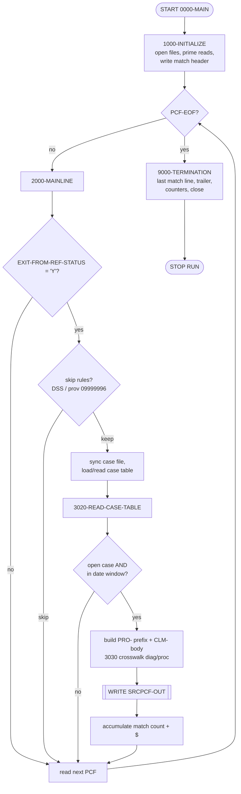
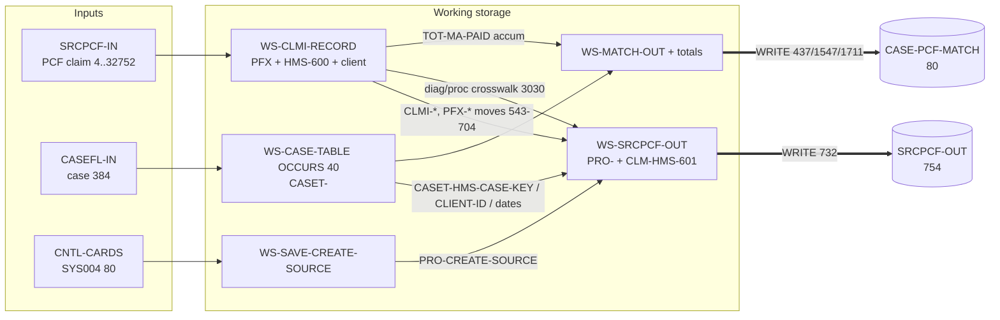
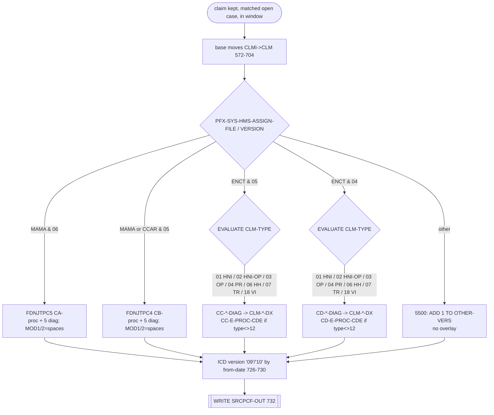

# CASPCFNJ — Comprehensive Field‑Mapping Analysis

*Program:* `CASPCFNJ`  ·  *Repository:* `swatisable/Mainframe`  ·  *Folder:* repository root
*Companion workbook:* `CASPCFNJ_1x1_Field_Mapping.xlsx` (4 sheets)
*Generator:* `generate_mapping_workbook.py`

> **Evidence rule.** Every mapping in this report and in the workbook points to a real
> line in `CASPCFNJ`. Line numbers below are the `view`/editor line numbers of the file
> in this repository. Anything that could not be read from committed source (copybook PIC
> clauses and byte offsets) is called out explicitly and marked `[UNCERTAIN]` or
> *illustrative*; nothing about those layouts is silently guessed.

---

## 1. Overview and purpose

`CASPCFNJ` extracts **PCF (Provider Claim File) claim data** for Medicaid recipients that
match **open cases** from the CAS2000 system, reformats each matched claim into the HMS‑601
output layout, and writes two outputs: a reformatted claim‑extract file and a human‑readable
match‑summary report.

From the program abstract (lines 7‑18):

> *"THIS PROGRAM EXTRACTS PCF CLAIM DATA BASED ON CASE DATA FROM CAS2000 SYSTEM. IT IS CLONE
> OF PROGRAM CASPCFDA … THIS PROGRAM IS UPDATED VERSION OF CASPCFM1 PGM … CUS0136047 ‑
> CTSCASNJ ‑ MAINFRAME CLAIM PULL."*

**Program role (one of the required categories): Reformat + Multi‑output with record
selection (filter).**

* **Reformat** — the input claim layout (`FDPCF602`, "HMS‑600") and output claim layout
  (`FDPCF601`, "HMS‑601", described as *"WITH INCREASED SIZE DIAG CODE"*, line 222) are
  **different**; the body is rebuilt field‑by‑field (≈106 moves, lines 572‑704) instead of a
  single group move (the original `MOVE CLMI-HMS-600 TO CLM-HMS-601` is commented out at
  lines 569‑570).
* **Multi‑output** — two output files are produced: `SRCPCF-OUT` (claim extract) and
  `CASE-PCF-MATCH` (summary report).
* **Filter / selection** — records are skipped by provider, DSS, reference‑status and
  date‑window rules (see §12).

---

## 2. Inputs reviewed

| Artifact | Kind | In repo? | Notes |
|---|---|---|---|
| `CASPCFNJ` | COBOL program (1,720 lines) | ✅ | The only committed source file. |
| `SRCPCF-IN` → `CLMI-RECORD` | Input PCF claim file | ✅ FD only | `RECORD IS VARYING 4..32752 DEPENDING ON PCF-DEP` (lines 39‑48). |
| `CASEFL-IN` → `CASE-RECORD` | Input CAS2000 case master | ✅ FD only | `PIC X(384)`, fixed (lines 50‑54). |
| `CNTL-CARDS` → `CNTL-REC` | Input control cards (SYS004) | ✅ FD only | `PIC X(80)`, fixed (lines 33‑38). |
| `SRCPCF-OUT` → `CLMO-RECORD` | Output claim extract | ✅ FD only | `PIC X(754)`, fixed (lines 57‑63). |
| `CASE-PCF-MATCH` → `MATCH-RECORD` | Output match report | ✅ FD only | `PIC X(80)`, fixed (lines 66‑71). |
| Copybooks (18 `COPY` statements) | Record layouts | ❌ **Absent** | See the list in §11 — **none** are committed. |

**Key constraint.** The data *layouts* live in copybooks that are **not present** in this
repository (confirmed: `git ls-files` lists only `CASPCFNJ`). The record‑level FDs give the
overall record sizes, and the inline `WS-MATCH-OUT` group gives the complete match‑report
layout, but the elementary PICs / byte offsets of the PCF claim layouts cannot be read from
source. This is the single biggest analysis gap (see §14).

---

## 3. Program architecture and flow

Driver paragraph `0000-MAIN` (lines 359‑366):

```
PERFORM 1000-INITIALIZE
PERFORM 2000-MAINLINE UNTIL PCF-EOF
PERFORM 9000-TERMINATION
STOP RUN
```

| Paragraph | Lines | Responsibility |
|---|---|---|
| `1000-INITIALIZE` | 370‑395 | Open files; prime reads of PCF, case, and control cards; init 30‑entry table; write match header. |
| `1500-READ-SRCPCF-IN` | 397‑406 | Read PCF claim `INTO WS-CLMI-RECORD`; set `PCF-EOF`; count. |
| `1600-READ-CASEFL-IN` | 408‑420 | Read case `INTO WS-CASE-RECORD`; count open cases. |
| `1650-READ-CARDS` | 422‑433 | Read SYS004; tag `'1'` → `WS-SAVE-CREATE-SOURCE`. |
| `1700-WRITE-MATCH-HEADER` | 435‑441 | Emit report header + blank line. |
| `2000-MAINLINE` | 443‑509 | Sync case file to claim; apply skip rules; load/read case table; drive writes. |
| `3000-INITIALIZE-TABLE` | 511‑516 | `INITIALIZE WS-CASE-TABLE(SUB-I)`. |
| `3010-LOAD-CASE-TABLE` | 518‑530 | Load matched recipient's cases into the OCCURS‑40 table. |
| `3020-READ-CASE-TABLE` | 532‑748 | **Core mapping** — builds and writes each output claim. |
| `3030-REVIEW-CLMS-VERS` | 750‑979 | Diagnosis/procedure **crosswalk** by file type/version/claim type. |
| `4000-FORMAT-DATE` | 981‑1002 | Reformat incident/thru dates via `UNSTRING`. |
| `5500-PROCESS-RECS` | 1518‑1523 | "Other version" counter only. |
| `2100-WRITE-CASE-PCF-MATCH` | 1525‑1552 | Emit a match detail line (count + $ total). |
| `9000-TERMINATION` | 1554‑1705 | Final match line, trailer, counters, close. |
| `9100-WRITE-MATCH-TRAILER` | 1707‑1718 | "NO MATCHED…" / blank / all‑`*` trailer lines. |

Paragraphs `5100-INST/PROF/RX/ADJ-PROCESS-RECS*` (lines ~1004‑1516) are **entirely commented
out** and have no runtime effect; they are discussed only in §14.

### Overall flow (Mermaid)



---

## 4. Layout and copybook relationship

**Input claim record** `WS-CLMI-RECORD` (lines 152‑159) is three concatenated pieces:

```
WS-CLMI-RECORD  (read area for SRCPCF-IN)
├── TPLPREFX   (prefix, PFX-)        ~127 bytes   "1ST 127 IS A 20"      (line 153-154)
├── CLMI-HMS-600 = FDPCF602 (CLMI-)  ~600 bytes   "2ND 600 IS A 20"      (line 155-157)
└── CLMI-CLIENT-DATA  PIC X(32025)                client-side remainder  (line 159)
                                      ─────────
                                      = 32,752  (matches FD max, line 42)
```

`CLMI-CLIENT-DATA` is re‑interpreted through client‑side copybooks depending on file
version (lines 198‑205): `INST-RECA=FDNJTPC5 (CA-)`, `CB…=FDNJTPC4 (CB-)`,
`INST-RECC=FDNJ5INS (CC-)`, `INST-RECD=FDNJ4INS (CD-)`.

**Output claim record** `WS-SRCPCF-OUT` (lines 217‑224):

```
WS-SRCPCF-OUT  (write area for SRCPCF-OUT, total 754 bytes)
├── PRO-CLMPRFX  = CLMPREFX (PRO-)    prefix area           (line 217-218)
└── CLM-HMS-601  = FDPCF601 (CLM-)    "WITH INCREASED SIZE DIAG CODE"  (line 223-224)
```

So the input HMS‑600 body and output HMS‑601 body are **sibling layouts** that differ mainly
in the **widened diagnosis/procedure code fields** — which is exactly why those fields are
populated separately by the crosswalk logic rather than by the straight pass‑through moves.

**Match report** `WS-MATCH-OUT` (lines 226‑235) is fully defined **inline** in
WORKING‑STORAGE, so its layout is known exactly (see §6).

---

## 5. Input formats

There is one physical PCF input file, but it carries **several logical claim formats**
distinguished at runtime by `PFX-SYS-HMS-ASSIGN-FILE` + `PFX-SYS-VERSION` and by
`CLMI-CLM-TYPE`. These drive the diagnosis/procedure crosswalk in `3030-REVIEW-CLMS-VERS`:

| Format | Condition (lines) | Client copybook | Prefix |
|---|---|---|---|
| MAMA v06 | `='MAMA'` AND `='06'` AND clm‑type ∈ list (764‑789) | `FDNJTPC5` | `CA-` |
| MAMA/CCAR v05 | ∈ `('MAMA','CCAR')` AND `='05'` AND clm‑type ∈ list (791‑817) | `FDNJTPC4` | `CB-` |
| ENCT v05 | `='ENCT'` AND `='05'`, `EVALUATE` clm‑type (819‑892) | `FDNJ5INS` | `CC-` |
| ENCT v04 | `='ENCT'` AND `='04'`, `EVALUATE` clm‑type (895‑969) | `FDNJ4INS` | `CD-` |
| Base / other | none of the above (970‑972 → 5500) | — (no overlay) | — |

The claim‑type list used by the MAMA branches is
`01,02,03,04,06,07,09,13,14,15,18,20,21,23` (lines 766‑779 / 794‑807). The ENCT branches
pick a diagnosis array per claim type: `01`→HNI, `02`→HNI‑else‑OP, `03`→OP, `04`→PR,
`06`→HH, `07`→TR, `18`→VI.

The two non‑claim inputs are single‑format: `CASEFL-IN` (NCTCASE, 384 bytes) and
`CNTL-CARDS` (80 bytes; only tag `'1'` is consumed).

---

## 6. Output layouts and write paths

### 6.1 `SRCPCF-OUT` — reformatted claim extract (`CLMO-RECORD PIC X(754)`)

Written once per qualifying claim: `WRITE CLMO-RECORD FROM WS-SRCPCF-OUT` (line 732).
Populated fields: **11 `PRO-` prefix fields** + **107 `CLM-` body fields** = 118 fields that
the program actually assigns. `PIC`/byte offsets come from `CLMPREFX`/`FDPCF601`, which are
**not in the repo** → marked `[UNCERTAIN]` in the workbook (inferred PIC supplied where the
code makes it determinable, e.g. the five `CLM-*-DX` fields and `CLM-PROCEDURE-CODE-7` are
`X(7)`, `CLM-CDE-ICD-VERSION` is `X(2)`).

### 6.2 `CASE-PCF-MATCH` — match summary report (`MATCH-RECORD PIC X(80)`)

Layout is fully known from `WS-MATCH-OUT` (lines 226‑235). **Byte offsets are exact:**

| Bytes | Field | PIC | Header literal | Detail source |
|---|---|---|---|---|
| 1‑3 | `FILLER` | `X(03)` | `' * '` | constant |
| 4‑23 | `MATCH-CASE-ID-OUT` | `X(20)` | `'CASE ID'` | `WS-CASE-ID` ← `CASET-RECIPIENT-ID-NUM(1)` (735, 1527) |
| 24‑26 | `FILLER` | `X(03)` | `' * '` | constant |
| 27‑45 | `MATCH-TOT-PCF-REC-OUT` | `X(19)` | `'PCF RECORDS MATCHED'` | `WS-CONVERT-MATCH` (edited `WS-TOT-PCF-REC-MATCH`) (1533) |
| 46‑48 | `FILLER` | `X(03)` | `' * '` | constant |
| 49‑66 | `MATCH-TOT-PCF-MA-PAID-OUT` | `X(18)` | `'PCF TOT $$ MA PAID'` | `WS-CONVERT-PCF-PAID` (edited `WS-TOT-PCF-MA-PAID`) (1540) |
| 67‑68 | `FILLER` | `X(02)` | `' *'` | constant |
| 69‑80 | (unused) | — | spaces | padding to the `X(80)` record |

Write paths: header (437), detail per case (1547), trailer lines (1711‑1716).

### Input‑to‑output flow (Mermaid)



---

## 7. Mapping methodology

1. **Extract every write to an output field.** The procedure division was parsed (comment
   lines — column‑7 `*` — removed) and every `MOVE … TO PRO-… / CLM-…` captured with its
   source and line number. Result: 11 `PRO-` targets, 107 `CLM-` targets, plus the inline
   `MATCH-` fields.
2. **Classify each field** into exactly one category (workbook *Mapping Type*): *1x1
   identity*, *direct MOVE (renamed)*, *derived/transformed*, *crosswalk/translated*,
   *hardcoded constant*, *default SPACES/ZEROS*, or *not populated*.
3. **Resolve working‑storage intermediaries** — e.g. `PRO-INCIDENT-DATE` traces back through
   `WS-INCIDENT-DATE` to `CASET-INCIDENT-DATE` via `4000-FORMAT-DATE`; `PRO-CREATE-SOURCE`
   traces through `WS-SAVE-CREATE-SOURCE` to the SYS004 card.
4. **Resolve loop subscripts** — the `VARYING SUB-I` loops (3010/3020) resolve to
   `CASET-… (SUB-I)` for the matched occurrence; the match id uses occurrence `(1)`.
5. **Separate columns per format/output** — the workbook carries one source column for each
   input format (MAMA v06, MAMA/CCAR v05, ENCT v05, ENCT v04, base) and an *Output Path*
   column (SRCPCF‑OUT vs CASE‑PCF‑MATCH).

---

## 8. Field‑level behavior (base rules + per‑path overrides)

**Base rule for the claim body (97 fields).** Each `CLMI-x` is moved to the identically‑named
`CLM-x` (prefix rename only), lines 573‑704 — classified **1x1 identity**. Values pass through
unchanged.

**Prefix area (`PRO-`, 11 fields).** Built in `3020-READ-CASE-TABLE` (lines 542‑563):

| Target | Source | Line | Type |
|---|---|---|---|
| `PRO-RECIPIENT-ID-NUM` | `CLMI-PCF-MA-NUM` | 543 | direct (renamed) |
| `PRO-HMS-CASE-KEY` | `CASET-HMS-CASE-KEY(SUB-I)` | 545 | direct (case table) |
| `PRO-CLIENT-ID` | `CASET-HMS-CLIENT-ID(SUB-I)` | 547 | direct (case table) |
| `PRO-CREATE-SOURCE` | `WS-SAVE-CREATE-SOURCE` | 553 | direct (control card) |
| `PRO-ICN` | `CLMI-ICN` → optional `WS-ICN-GROUP-19` | 554 / 718 | identity + override |
| `PRO-FORMER-ICN` | `CLMI-FORMER-ICN` | 555 | direct (renamed) |
| `PRO-XACTION-STATUS` | `CLMI-XACTION-STATUS` | 557 | direct (renamed) |
| `PRO-CLM-FROM-DATE` | `PFX-APP-DATE-OF-SERVICE` | 559 | direct (renamed) |
| `PRO-CLAIM-TRANS-TYPE` | `PFX-NET-CLAIM-TRANS-TYPE` | 561 | direct (renamed) |
| `PRO-INCIDENT-DATE` | `WS-INCIDENT-DATE` | 562 | derived (date) |
| `PRO-CLM-THRU-DATE` | `WS-CLM-THRU-DATE` | 563 | derived (date) |

**Per‑path overrides (claim body).** Nine `CLM-` fields have their final value **overridden**
after the base move (details in §10 and workbook Sheet 2):

* `CLM-PRI-DX`, `CLM-SEC-DX`, `CLM-DX-3`, `CLM-DX-4`, `CLM-DX-5` — crosswalk by format/claim type.
* `CLM-PROCEDURE-CODE-7` — crosswalk; base is `CLMI-PROCEDURE-CODE-5`.
* `CLM-PROCEDURE-CODE-MOD1`, `CLM-PROCEDURE-CODE-MOD2` — base from `CLMI`, then **cleared to
  SPACES** in every crosswalk path.
* `CLM-ICN` — base `CLMI-ICN`, optional ICN+suffix rebuild (720).

**Derived‑only field.** `CLM-CDE-ICD-VERSION` is never set by the base block; it is derived
from the service date at lines 726‑730 (`'09'` / `'10'`).

---

## 9. Initialization and defaulting (SPACES, ZEROS, constants)

* `INITIALIZE WS-COUNTERS` (line 379) and per‑occurrence `INITIALIZE WS-CASE-TABLE(SUB-I)`
  (513) zero/space the counters and table.
* `INITIALIZE PRO-CLMPRFX` (line 542) resets the **entire prefix area** before the 11 `PRO-`
  moves — so any `CLMPREFX` field the program does **not** set is left at its `INITIALIZE`
  default (SPACES for alphanumeric, ZEROS for numeric).
* The `CLM-HMS-601` body is **not** blanket‑initialized each cycle; every field is overwritten
  by the 572‑704 moves. Any `FDPCF601` field not in that list retains whatever the copybook /
  prior record left (a residual‑data risk — see §14).
* **Constants:** the match report delimiters `' * '`, `' *'` and the header literals
  `'CASE ID'`, `'PCF RECORDS MATCHED'`, `'PCF TOT $$ MA PAID'` (lines 227‑234); the ICD codes
  `'09'`/`'10'` (727/729); `'99999999'` default thru‑date (999); the trailer literals
  `'NO MATCHED PCF RECORDS FOUND'` (1710) and `ALL '*'` (1715).
* **SPACES overrides:** `CLM-PROCEDURE-CODE-MOD1/MOD2` are forced to SPACES in all crosswalk
  branches (782‑783, 810‑811, 890‑891, 967‑968).

---

## 10. Transformation and crosswalk logic

**Date reformatting (`4000-FORMAT-DATE`, 981‑1002).**
`CASET-INCIDENT-DATE` (e.g. `YYYY-MM`) is `UNSTRING`ed into `WS-IN-YYYY`/`WS-IN-MM`, copied to
`WS-INCIDENT-DATE-NEW`, and the **day is forced to `01`** (990‑991). `CASET-CLAIMS-THRU-DATE`
is `UNSTRING`ed into YYYY/MM/DD, or defaults to `'99999999'` when blank (999). These feed the
date‑window test and `PRO-INCIDENT-DATE` / `PRO-CLM-THRU-DATE`.

**ICD version (726‑730).** `IF PRO-CLM-FROM-DATE < 20151001 → '09' ELSE '10'` into
`CLM-CDE-ICD-VERSION` — a date‑to‑code derivation (ICD‑9 vs ICD‑10 cutover 2015‑10‑01).

**ICN suffix reformat (706‑723).** When
`PM-USER-AREA(1:2) ∈ {'PB','DT'}` AND `PCF-CONTRACT-NUM='0032600'` AND
`PM-USER-AREA(27:3) ≠ 'DSS'` AND `PCF-HMS-ICN-SUFFIX` is numeric and ≠ 0, the ICN is rebuilt
as `WS-ICN-GROUP-19 = WS-ICN-17 (CLMI-ICN) + WS-ICN-02 (suffix)` and stored to both `PRO-ICN`
and `CLM-ICN` (714‑720).

**Provider substitution (564‑568).** If `PROV-OF-SVC-NUM='09999996'` AND
`PCF-CONTRACT-NUM='0032600'`, `CLMI-PAY-TO-PROV-NUM` replaces `CLMI-PROV-OF-SVC-NUM` before it
is moved to `CLM-PROV-OF-SVC-NUM`.

**Diagnosis / procedure crosswalk (`3030-REVIEW-CLMS-VERS`, 750‑979).** Selects a client‑side
layout by file/version and overlays up to five diagnosis codes and one procedure code onto the
widened `CLM-*-DX` / `CLM-PROCEDURE-CODE-7` fields (see §5 table and workbook Sheet 2). ENCT
branches choose the diagnosis array by claim type via `EVALUATE`.

**Match totals (2100, 1525‑1552).** `WS-TOT-PCF-REC-MATCH` (count) and `WS-TOT-PCF-MA-PAID`
(sum of `CLMI-TOT-MA-PAID-HDR`, line 739) are moved to edited pictures `ZZZZ9` and
`$$$,$$$,$$$,$$9.99`, then **left‑trimmed** via `INSPECT … TALLYING … FOR ALL SPACES` before
being placed in the report. On COMP‑3 overflow, `SIZE-ERROR` is set and the literal
`'TOO MANY MATCHES, $$ PAID NOT AVAILABLE !'` is written instead (1543).

### Routing decision tree (Mermaid)



---

## 11. Dependencies (copybooks, called programs)

**Called programs:** none. `CASPCFNJ` has **no `CALL` statements**; it ends with `STOP RUN`
(365). All logic is in‑line `PERFORM`s.

**Copybooks referenced by active `COPY` statements (none committed to the repo):**

| Copybook | Replacing → prefix | Used for | Line |
|---|---|---|---|
| `NCTCASE` | `CASET-` / `CASE-` | case table input / case record | 145, 211 |
| `TPLPREFX` | `PFX-` | TPL prefix on each claim | 154 |
| `FDPCF602` | `CLMI-` | input claim body (HMS‑600) | 157 |
| `FDPCF601` | `CLM-` | **output** claim body (HMS‑601) | 224 |
| `CLMPREFX` | `PRO-` | **output** prefix area | 218 |
| `FDNJTPC5` | `CA-` | client overlay, MAMA v06 | 199 |
| `FDNJTPC4` | `CB-` | client overlay, MAMA/CCAR v05 | 201 |
| `FDNJ5INS` | `CC-` | client overlay, ENCT v05 | 203 |
| `FDNJ4INS` | `CD-` | client overlay, ENCT v04 | 205 |
| `FDNMINS3/2`, `FDNMMED3/2`, `FDNMRX3/2`, `FDNMADJ3/2` | `I3/I2`,`P3/P2`,`R3/R2`,`A3/A2` | declared but used only by commented‑out `5100-*` paragraphs | 166‑192 |

> Because `FDPCF601`, `CLMPREFX`, and `FDPCF602` are absent, the claim‑side PIC clauses and
> byte offsets in Sheet 1 are `[UNCERTAIN]`. The mapping *relationships* (source→target, line)
> are **not** uncertain — they are read directly from the `MOVE`s.

---

## 12. Skip / reject / stop / abend conditions

| # | Condition | Action | Lines |
|---|---|---|---|
| 1 | `PFX-SYS-EXIT-FROM-REF-STATUS ≠ 'Y'` | read next PCF, skip | 452‑455 |
| 2 | DSS record: `PCF-CONTRACT-NUM='0032600'` AND `PM-USER-AREA(27:3)='DSS'` AND `0040000 < CLAIM-FROM-DOS < 0900000` | `ADD 1 TO REC-SKIP-DSS`, skip | 457‑469 |
| 3 | Placeholder provider: `PROV-OF-SVC-NUM='09999996'` AND `PAY-TO-PROV-NUM='09999996'` | `ADD 1 TO REC-SKIP-PROV`, skip | 471‑476 |
| 4 | Case not open (`CASE-STATUS-CODE` ≠ `'O'`/`X'96'`) | claim not written for that case | 537‑538 |
| 5 | Out of date window: `APP-DATE-OF-SERVICE` < incident‑date OR > claims‑thru‑date | claim not written | 540‑541 |
| 6 | No recipient match (`CASE-RECIPIENT-ID-NUM` vs `PFX-APP-MEDICAID-NO`) | claim not written | 445‑501 |
| 7 | COMP‑3 overflow on match totals | set `SIZE-ERROR`, write `'TOO MANY MATCHES…'` (no abend) | 737‑744, 1542‑1546 |

**Stop / termination.** `2000-MAINLINE` loops `UNTIL PCF-EOF`; **processing stops at end of the
PCF file**, so the case file may not be fully read (documented in the code at lines 1561‑1577).
`STOP RUN` is at line 365. There is **no explicit `ABEND`/error‑stop** path and no
`DECLARATIVES`; the size‑error case degrades gracefully to a message line.

---

## 13. Worked example (using the sample records)

A single coherent example (fully listed on workbook **Sheet 4**; values *illustrative* because
copybook PICs are absent):

* **Control card:** tag `'1'`, `CARD-DATA='NJ'` → `WS-SAVE-CREATE-SOURCE='NJ'`.
* **Case (open):** `CASE-RECIPIENT-ID-NUM='12345678901234567890'`, `STATUS='O'`,
  `HMS-CASE-KEY='CASE0001234567890'`, `HMS-CLIENT-ID='CLIENT0001'`,
  `INCIDENT-DATE='2015-03'` → `20150301`, `CLAIMS-THRU-DATE='2016-06-30'` → `20160630`.
* **Claim (kept):** `EXIT-FROM-REF-STATUS='Y'`, `APP-MEDICAID-NO='12345678901234567890'`
  (matches), `APP-DATE-OF-SERVICE=20150315` (in window), file/version `MAMA/06`, clm‑type `01`,
  `ICN='20151234567890123'`, `HMS-ICN-SUFFIX='07'`, `PM-USER-AREA(1:2)='PB'`,
  `CONTRACT='0032600'`, `TOT-MA-PAID-HDR=1234.56`, `CA-A-PROC-CDE='0360T'`,
  `CA-A-DIAG-CDE(1)='E119'`, `(2)='I10'`.

**Output 1 (`SRCPCF-OUT`)** key fields: `PRO-RECIPIENT-ID-NUM=12345678901234567890`,
`PRO-HMS-CASE-KEY=CASE0001234567890`, `PRO-CLIENT-ID=CLIENT0001`, `PRO-CREATE-SOURCE=NJ`,
`PRO-ICN=2015123456789012307` (ICN+suffix), `PRO-CLM-FROM-DATE=20150315`,
`PRO-INCIDENT-DATE=20150301`, `PRO-CLM-THRU-DATE=20160630`; body
`CLM-CLM-TYPE=01`, `CLM-PROCEDURE-CODE-7=0360T`, `CLM-PROCEDURE-CODE-MOD1/2=spaces`,
`CLM-PRI-DX=E119`, `CLM-SEC-DX=I10`, `CLM-ICN=2015123456789012307`,
`CLM-CDE-ICD-VERSION=09` (service date < 2015‑10‑01), `CLM-TOT-MA-PAID-HDR=1234.56`, and
≈100 other `CLM-*` fields equal to their `CLMI-*` sources.

**Output 2 (`CASE-PCF-MATCH`)** detail line:
`' * 12345678901234567890 * 1 * $1,234.56 *'` — case id (4‑23), matched‑count (27‑45), and
`$` total (49‑66), delimited by the `' * '` fillers.

---

## 14. Gaps, assumptions, and risks

1. **Copybooks absent (highest‑impact).** `FDPCF601`, `FDPCF602`, `CLMPREFX`, `TPLPREFX`,
   `NCTCASE`, and the four client overlays are not in the repo. Consequences: claim‑side PIC
   clauses, byte offsets, signs and decimal positions are `[UNCERTAIN]`; and **output fields the
   program never references cannot be enumerated**. Sheet 1 therefore lists the **118 populated
   claim fields** plus an explicit note row for the remaining copybook fields. *To fully satisfy
   "list every output field", commit `FDPCF601` and `CLMPREFX` and re‑run the generator.*
2. **Sample values are illustrative.** Without PICs, lengths/types are inferred from field
   names and comparisons; every made‑up value is marked *illustrative*. Inferred PICs are given
   only where the code forces them (diag/proc `X(7)`, ICD `X(2)`, `CLAIM-FROM-DOS` `9(7)`).
3. **Residual data in `CLM-HMS-601`.** The body is not re‑initialized per cycle (only
   `PRO-CLMPRFX` is). Any `FDPCF601` field outside the 572‑704 move list could carry prior
   content; this cannot be verified without the copybook.
4. **Dead code.** The `5100-INST/PROF/RX/ADJ-PROCESS-RECS*` paragraphs and the
   `FDNMINS/MED/RX/ADJ*` copybooks are commented out; the active diagnosis/procedure logic is
   entirely in `3030`. They are excluded from the mapping on purpose.
5. **Apparent quirks (left as‑is; not "fixed").** ENCT type‑`02` maps `*-DIAG(3)` to `CLM-DX-5`
   (lines 852/928); ENCT type‑`04` under `CD-` skips `SEC-DX` (942‑945); duplicate
   `CC/CD-HNI-DIAG(4) → CLM-DX-4` moves (828/904). These match the source exactly and are flagged
   rather than altered.
6. **Match report width.** `WS-MATCH-OUT` defines 68 bytes; the record is `X(80)`, so bytes
   69‑80 are spaces — consistent, noted for completeness.

---

## 15. Conclusion

`CASPCFNJ` is a **reformat + multi‑output** extract: it selects PCF claims that match **open
CAS2000 cases** by Medicaid id and service‑date window, rebuilds each claim from the HMS‑600
input layout into the widened HMS‑601 output layout (≈106 identity moves plus a
diagnosis/procedure **crosswalk** keyed on file type/version/claim type), stamps an 11‑field
`PRO-` prefix, and writes `SRCPCF-OUT`; in parallel it accumulates per‑case counts and dollar
totals into the 80‑byte `CASE-PCF-MATCH` report. Every mapping in the companion workbook is
tied to a specific source line. The **only** material limitation is the **absence of the claim
copybooks** (`FDPCF601` / `CLMPREFX` / `FDPCF602`), which blocks exact PIC/byte reporting and
the enumeration of never‑populated fields for the claim output; committing those copybooks and
re‑running `generate_mapping_workbook.py` would close that gap. The `CASE-PCF-MATCH` output,
being defined inline, is documented completely and exactly.

---

### Appendix — final checklist

- [x] Program role and layout relationship stated (§1, §4)
- [x] Workbook has exactly 4 sheets
- [x] Every **populated** output field appears as a row (118 claim + 7 match + 1 gap note); unpopulated copybook fields flagged (copybooks absent)
- [x] Every field classified (Mapping Type column)
- [x] Working‑storage chains and loop subscripts resolved (§7, §8, §10)
- [x] Separate columns for each format/output (Sheet 1)
- [x] Sample input/output values for every field (marked *illustrative* where PIC unknown)
- [x] At least one full sample record per input format (Sheet 4)
- [x] Overrides and crosswalks listed in Sheet 2
- [x] Skip/reject/abend conditions documented (§12, Sheet 3)
- [x] Exact field names used from source; PIC clauses exact where known, `[UNCERTAIN]` where copybooks are absent
