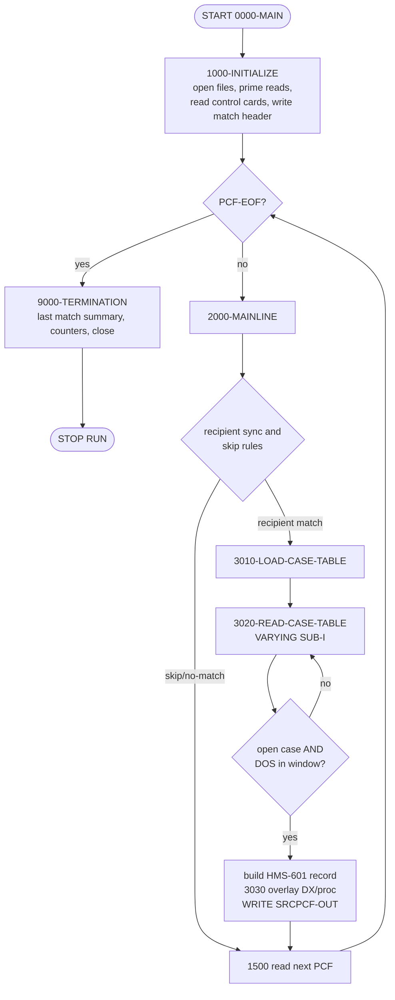
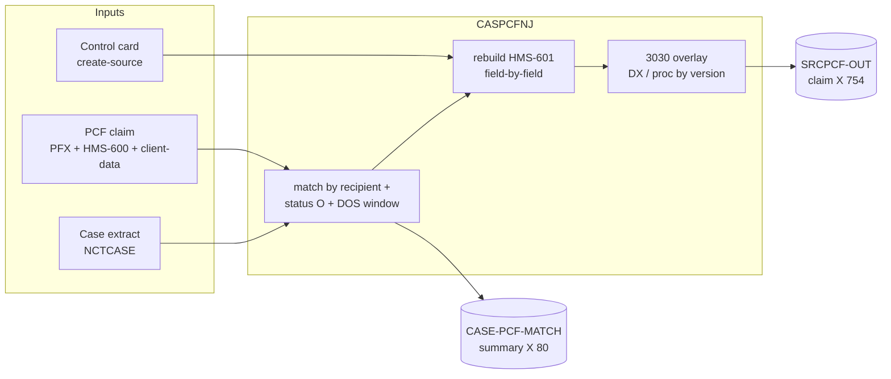
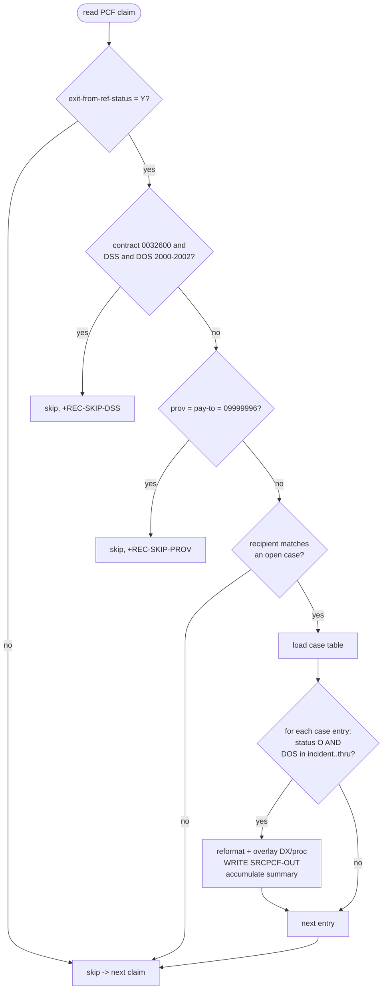

# CASPCFNJ — Comprehensive Field‑Mapping Analysis

> **Companion workbook:** `CASPCFNJ_1x1_Field_Mapping.xlsx` (4 sheets)
> **Generator:** `generate_caspcfnj_mapping.py` (parses the real COBOL and emits the workbook)
> **Program analyzed:** `CASPCFNJ` (1,720 lines) in the repository root.

### Evidence & honesty notes (please read first)

* Every mapping in this report and in the workbook is traced to a **real,
  active (non‑comment) line** of `CASPCFNJ`. Line references use the file's
  own physical line numbers (e.g. `L572`).
* The program `COPY`s several **external copybooks that are *not present* in
  this repository** (`TPLPREFX`, `FDPCF602`, `NCTCASE`, `FDNJTPC5`,
  `FDNJTPC4`, `FDNJ5INS`, `FDNJ4INS`, `CLMPREFX`, `FDPCF601`). Because those
  members are absent, the exact **PICTURE clauses and absolute byte offsets**
  of the `PRO‑`, `CLM‑`, `CLMI‑`, `PFX‑`, and `CASET‑` fields **cannot be
  proven** and are marked `[UNCERTAIN: copybook not in repo]`.
* The **match‑report record** (`WS‑MATCH‑OUT`, file `CASE‑PCF‑MATCH`) is fully
  defined *inside* the program (`L226‑L235`), so its PICs and byte positions
  **are exact**.
* Any fabricated sample value is suffixed **`(illus.)`** for *illustrative*,
  per the "do not guess" rule.

---

## 1. Overview and purpose

`CASPCFNJ` is a batch extract/reformat program (author `MXM`, written
2016‑01‑21, last changed 2025‑07‑21 under `CHG2724516` / `CUS0136047 –
CTSCASNJ – MAINFRAME CLAIM PULL`). Per its own abstract (`L7‑L19`) it:

> *"extracts PCF claim data based on case data from the CAS2000 system … it is
> a clone of program CASPCFDA … updated version of CASPCFM1."*

In plain terms, it reads a large **PCF claims file** and an **open‑case
extract**, and for every claim that belongs to an **open case** whose
service‑date window contains the claim's date of service, it **reformats** the
claim from the input claim layout (`HMS‑600` / `FDPCF602`) to a slightly larger
output layout (`HMS‑601` / `FDPCF601`, whose diagnosis area was enlarged for
ICD‑10) and writes it out. It simultaneously produces a human‑readable
**match summary** report.

**Program role (single best fit): Reformat + Filter/Match + Multi‑output.**

| Role dimension | Finding |
|----------------|---------|
| Passthrough? | No — input and output claim layouts differ (`FDPCF602` → `FDPCF601`). |
| Filter/splitter? | Yes — claims are selected by case match, date window, and several skip rules. |
| Reformat? | Yes — the record is rebuilt **field‑by‑field** (the bulk `MOVE CLMI‑HMS‑600 TO CLM‑HMS‑601` is commented out at `L569‑L570`). |
| Multi‑output? | Yes — writes `SRCPCF‑OUT` (claims) **and** `CASE‑PCF‑MATCH` (summary). |
| Bulk‑move length | **None** — there is no whole‑record move; see `L569‑L570`. |

---

## 2. Inputs reviewed

| Artifact | DD / ASSIGN | In‑program record | Size | Copybook(s) | In repo? |
|----------|-------------|-------------------|------|-------------|----------|
| PCF claims (input) | `SRCPCFI` | `CLMI‑RECORD` → `WS‑CLMI‑RECORD` | `X(32752)` VB | `TPLPREFX` (PFX), `FDPCF602` (CLMI), client‑data | ❌ |
| Open‑case extract | `CASEFLI` | `CASE‑RECORD` → `WS‑CASE‑RECORD` / table | `X(384)` | `NCTCASE` (CASET/CASE) | ❌ |
| Control cards | `SYS004` | `CNTL‑REC` → `CARD‑REC` | `X(80)` | in‑program `CARD‑REC` (`L237‑242`) | ✅ (in‑program) |
| **Claim output** | `SRCPCFO` | `CLMO‑RECORD` ← `WS‑SRCPCF‑OUT` | `X(754)` | `CLMPREFX` (PRO), `FDPCF601` (CLM) | ❌ |
| **Match summary** | `MATCHO` | `MATCH‑RECORD` ← `WS‑MATCH‑OUT` | `X(80)` | in‑program `WS‑MATCH‑OUT` (`L226‑235`) | ✅ (in‑program) |

`SELECT`/`FD` evidence: `L25‑L29`, `L34‑L71`. Control‑card handling:
`L422‑L433` (reads cards; `CARD‑TAG='1'` stores `CARD‑DATA(1:2)` into
`WS‑SAVE‑CREATE‑SOURCE`).

---

## 3. Program architecture and flow

Paragraph map (all active):

| Paragraph | Lines | Responsibility |
|-----------|-------|----------------|
| `0000‑MAIN` | L359‑368 | Init → mainline loop until `PCF‑EOF` → terminate. |
| `1000‑INITIALIZE` | L370‑395 | Open files, prime reads, read all control cards, init case table, write match header. |
| `1500‑READ‑SRCPCF‑IN` | L397‑406 | Read a PCF claim `INTO WS‑CLMI‑RECORD`. |
| `1600‑READ‑CASEFL‑IN` | L408‑420 | Read a case record; count open cases. |
| `1650‑READ‑CARDS` | L422‑433 | Load `WS‑SAVE‑CREATE‑SOURCE` from control card `'1'`. |
| `1700‑WRITE‑MATCH‑HEADER` | L435‑441 | Emit summary header + blank line. |
| `2000‑MAINLINE` | L443‑509 | Recipient sync, skip rules, drive matching, read next claim. |
| `3000‑INITIALIZE‑TABLE` | L511‑516 | Clear a case‑table occurrence. |
| `3010‑LOAD‑CASE‑TABLE` | L518‑530 | Load all case rows for one recipient into the table. |
| `3020‑READ‑CASE‑TABLE` | L532‑748 | **Build & write** one output claim per matching open case. |
| `3030‑REVIEW‑CLMS‑VERS` | L750‑979 | Overlay DX / procedure codes from the correct client‑data layout. |
| `4000‑FORMAT‑DATE` | L981‑1002 | Build incident/thru dates from `CASET` dates via `UNSTRING`. |
| `5500‑PROCESS‑RECS` | L1518‑1523 | Fallback counter for unrecognised file/version. |
| `2100‑WRITE‑CASE‑PCF‑MATCH` | L1525‑1552 | Emit one summary detail line per matched case‑id. |
| `9000‑TERMINATION` | L1554‑1705 | Final summary line, counters display, close files. |
| `9100‑WRITE‑MATCH‑TRAILER` | L1707‑1718 | Emit summary trailer. |

*(The `5100‑…‑PROCESS‑RECS1..4` paragraphs for INST/PROF/RX/ADJ, `L1004‑L1516`,
are **entirely commented out** and therefore dead code.)*



---

## 4. Layout and copybook relationship

**Input claim** `WS‑CLMI‑RECORD` (`L152‑159`) is three concatenated pieces:

```
+-------------------------+------------------------------+-------------------------------+
| TPLPREFX  (prefix PFX)  | CLMI-HMS-600 (FDPCF602/CLMI) | CLMI-CLIENT-DATA  X(32025)    |
| "1ST 127 IS A 20"       | "2ND 600 IS A 20"            | client-side remainder         |
|  ~127 bytes             |  600 bytes                   |  32025 bytes                  |
+-------------------------+------------------------------+-------------------------------+   = 32752
```

**Output claim** `WS‑SRCPCF‑OUT` (`L217‑224`) is two pieces:

```
+-------------------------+------------------------------+
| CLMPREFX  (prefix PRO)  | CLM-HMS-601 (FDPCF601/CLM)   |
| output claim prefix     | "WITH INCREASED SIZE DIAG"   |   = 754 total
+-------------------------+------------------------------+
```

Relationship: the input body `FDPCF602` and output body `FDPCF601` are **sibling
layouts** that differ chiefly in the **enlarged diagnosis/procedure area**
(ICD‑10). That is precisely why the program copies **field by field** instead
of one bulk move (`L569‑570` shows the bulk move commented out). The commented
`FDPCF600` alternative (`L220‑221`) is the pre‑ICD‑10 output body, now replaced
by `FDPCF601` (`L223‑224`).

The DX/procedure values are then **re‑derived** from the version‑specific
**client‑data** layouts that overlay `CLMI‑CLIENT‑DATA` (see §10).

---

## 5. Input formats

There is **one physical input claim file**, but its client‑data tail is parsed
through **one of four client‑data layouts**, chosen by two prefix fields
(`PFX‑SYS‑HMS‑ASSIGN‑FILE`, `PFX‑SYS‑VERSION`) and the claim type
(`CLMI‑CLM‑TYPE`):

| "Format" (file / version) | Client‑data layout | Prefix | Lines |
|---------------------------|--------------------|--------|-------|
| `MAMA` v`06` | `FDNJTPC5` → `INST‑RECA` | `CA‑` | L198‑199, L764‑789 |
| `MAMA`/`CCAR` v`05` | `FDNJTPC4` → `CB‑CLMS‑ACTIVITY‑RECORD` | `CB‑` | L201, L791‑816 |
| `ENCT` v`05` | `FDNJ5INS` → `INST‑RECC` | `CC‑` | L202‑203, L819‑892 |
| `ENCT` v`04` | `FDNJ4INS` → `CD‑ENC‑ACTIVITY‑RECORD` | `CD‑` | L205, L895‑969 |
| anything else | *(none)* — `5500‑PROCESS‑RECS` only counts | — | L970‑972, L1518‑1523 |

The **case input** has a single fixed layout (`NCTCASE`, 384 bytes). The
**control card** has a single 2‑byte payload used for the create‑source.

---

## 6. Output layouts and write paths

### 6.1 `SRCPCF‑OUT` — reformatted claim (`X(754)`)
Written at **`L732`** `WRITE CLMO‑RECORD FROM WS‑SRCPCF‑OUT`, inside the
`3020` per‑case loop. One claim can produce **0, 1, or many** output records
— one for each matching open case in the loaded case table.

### 6.2 `CASE‑PCF‑MATCH` — match summary (`X(80)`)
`WS‑MATCH‑OUT` layout (exact, from `L226‑235`):

| Field | PIC | Bytes | Value / Source |
|-------|-----|------:|----------------|
| `FILLER` | `X(03)` | 1–3 | `' * '` |
| `MATCH‑CASE‑ID‑OUT` | `X(20)` | 4–23 | header `'CASE ID'`; detail ← `WS‑CASE‑ID` (`L1527`) |
| `FILLER` | `X(03)` | 24–26 | `' * '` |
| `MATCH‑TOT‑PCF‑REC‑OUT` | `X(19)` | 27–45 | header `'PCF RECORDS MATCHED'`; detail ← edited `WS‑TOT‑PCF‑REC‑MATCH` |
| `FILLER` | `X(03)` | 46–48 | `' * '` |
| `MATCH‑TOT‑PCF‑MA‑PAID‑OUT` | `X(18)` | 49–66 | header `'PCF TOT $$ MA PAID'`; detail ← edited `WS‑TOT‑PCF‑MA‑PAID` |
| `FILLER` | `X(02)` | 67–68 | `' *'` |
| *(unused tail)* | `X(12)` | 69–80 | record is `X(80)`; remainder spaces |

Write paths for the summary: header (`L437‑439`), detail per matched case‑id
(`L1547`), and trailer (`L1711/1714/1716`).



---

## 7. Mapping methodology

1. The source was tokenised with mainframe fixed‑format rules (cols 1–6 =
   change flag, col 7 = comment indicator, cols 8+ = code). Comment lines
   (`*`/`/` in col 7) were excluded.
2. All **291 active `MOVE a TO b` statements** were extracted with their line
   numbers (the generator re‑derives these at run time).
3. For each distinct `PRO‑`/`CLM‑` target, the **first** active assignment in
   the record‑build path fixes its position in copybook order; later
   conditional assignments are recorded as **overrides**.
4. Each field was classified into exactly one base type and annotated with its
   source, code line, override behaviour, and an illustrative sample.
5. Cross‑check: **118 distinct `PRO‑`/`CLM‑` code targets ↔ 118 rows** in the
   workbook (0 missing, 0 invented). The match record adds 8 rows; note rows
   cover the un‑referenced remainder of each output copybook.

Classification vocabulary: *1x1 identity · direct MOVE (renamed) ·
derived/transformed · crosswalk/translated · hardcoded constant · default
SPACES/ZEROS · not populated.*

---

## 8. Field‑level behavior (base rules + per‑path overrides)

**Base rule for the claim body:** the vast majority of `CLM‑*` fields are a
**1x1 identity** copy of the identically‑named `CLMI‑*` input field
(`L572‑L704`); the only reason the copy is explicit is the enlarged diag area.

**Prefix (`PRO‑`) fields** are populated from mixed sources (`L542‑563`):

| Target | Source | Type | Line |
|--------|--------|------|------|
| `PRO‑RECIPIENT‑ID‑NUM` | `CLMI‑PCF‑MA‑NUM` | direct MOVE | L543 |
| `PRO‑HMS‑CASE‑KEY` | `CASET‑HMS‑CASE‑KEY(SUB‑I)` | direct MOVE (from case table) | L544 |
| `PRO‑CLIENT‑ID` | `CASET‑HMS‑CLIENT‑ID(SUB‑I)` | direct MOVE (from case table) | L546 |
| `PRO‑CREATE‑SOURCE` | `WS‑SAVE‑CREATE‑SOURCE` | direct MOVE (control card) | L552 |
| `PRO‑ICN` | `CLMI‑ICN` (+ suffix rebuild) | 1x1 + conditional derived | L554 / L717 |
| `PRO‑FORMER‑ICN` | `CLMI‑FORMER‑ICN` | 1x1 identity | L555 |
| `PRO‑XACTION‑STATUS` | `CLMI‑XACTION‑STATUS` | 1x1 identity | L556 |
| `PRO‑CLM‑FROM‑DATE` | `PFX‑APP‑DATE‑OF‑SERVICE` | direct MOVE | L558 |
| `PRO‑CLAIM‑TRANS‑TYPE` | `PFX‑NET‑CLAIM‑TRANS‑TYPE` | direct MOVE | L560 |
| `PRO‑INCIDENT‑DATE` | `WS‑INCIDENT‑DATE` | derived (date reformat) | L562 |
| `PRO‑CLM‑THRU‑DATE` | `WS‑CLM‑THRU‑DATE` | derived (date reformat) | L563 |

**Fields with per‑path overrides** (final value depends on client‑data
version / claim type — see §10 and workbook Sheet 2):

* `CLM‑PROCEDURE‑CODE‑7` — base `CLMI‑PROCEDURE‑CODE‑5` (resize 5→7, `L574`),
  overlaid by `CA/CB/CC/CD` proc code.
* `CLM‑PROCEDURE‑CODE‑MOD1` / `‑MOD2` — base `CLMI‑*` (`L576/L578`), set to
  **SPACES** in every client‑data path.
* `CLM‑PRI‑DX`, `CLM‑SEC‑DX`, `CLM‑DX‑3`, `CLM‑DX‑4`, `CLM‑DX‑5` — base
  `CLMI‑*` (`L602/603/675/676/677`), overlaid by client‑data diagnosis codes.
* `PRO‑ICN` / `CLM‑ICN` — base `CLMI‑ICN`, optionally rebuilt as
  `ICN(17) || suffix(02)` (`L706‑723`).
* `CLM‑PROV‑OF‑SVC‑NUM` — base `CLMI‑PROV‑OF‑SVC‑NUM`, whose *source* may first
  be swapped to `CLMI‑PAY‑TO‑PROV‑NUM` (`L564‑568`).
* `CLM‑CDE‑ICD‑VERSION` — no `CLMI` source; a **date‑based constant** (`L726‑730`).

---

## 9. Initialization and defaulting

* **Counters** `WS‑COUNTERS` → zeroes via `INITIALIZE WS‑COUNTERS` (`L379`).
* **Case table** occurrence cleared via `INITIALIZE WS‑CASE‑TABLE(SUB‑I)`
  (`L513`) before loading.
* **Output prefix** `INITIALIZE PRO‑CLMPRFX` (`L542`) before each matched
  record — so any `PRO‑` field not explicitly moved defaults to **SPACES/ZEROS**.
* **Date work area** `INITIALIZE WS‑COMPARE‑DATES` (`L983`) before each
  `4000‑FORMAT‑DATE`.
* **Constants:** `CLM‑CDE‑ICD‑VERSION` ← `'09'`/`'10'` (`L727/729`); the
  `MOD1`/`MOD2` fields ← `SPACES` in client‑data paths; the summary
  separators/headers are literal `VALUE`s in `WS‑MATCH‑OUT` (`L226‑235`).
* ⚠️ **`CLM‑HMS‑601` is *not* re‑initialised per record** — only the `PRO`
  prefix is. Any `FDPCF601` field not in the `MOVE` list keeps the previous
  record's value (see §14).

---

## 10. Transformation and crosswalk logic

### 10.1 Diagnosis / procedure crosswalk (`3030‑REVIEW‑CLMS‑VERS`, `L750‑979`)
The DX and procedure fields are overlaid from the client‑data layout selected
by `PFX‑SYS‑HMS‑ASSIGN‑FILE` + `PFX‑SYS‑VERSION`, then (for encounter layouts)
by `CLMI‑CLM‑TYPE`:

| File / version | DX source | Proc source | Notes |
|----------------|-----------|-------------|-------|
| `MAMA` v06 | `CA‑A‑DIAG‑CDE(1..5)` | `CA‑A‑PROC‑CDE` | claim types 01–23 list; `MOD1/2`→SPACES (L781‑788) |
| `MAMA`/`CCAR` v05 | `CB‑A‑DIAG‑CDE(1..5)` | `CB‑A‑PROC‑CDE` | same claim‑type list (L809‑816) |
| `ENCT` v05 | `CC‑{HNI,OP,PR,HH,TR,VI}‑DIAG` by claim type | `CC‑E‑PROC‑CDE` | `EVALUATE CLMI‑CLM‑TYPE` (L822‑886); proc only if type ≠ `12` |
| `ENCT` v04 | `CD‑{HNI,OP,PR,HH,TR,VI}‑DIAG` by claim type | `CD‑E‑PROC‑CDE` | `EVALUATE CLMI‑CLM‑TYPE` (L898‑964); proc only if type ≠ `12` |
| other | *(unchanged)* | *(unchanged)* | `5500‑PROCESS‑RECS` increments `OTHER‑VERS` |

### 10.2 ICD‑version flag (`L726‑730`)
`CLM‑CDE‑ICD‑VERSION = '09'` when `PRO‑CLM‑FROM‑DATE < 20151001`, else `'10'`
(the US ICD‑10 go‑live of 2015‑10‑01).

### 10.3 ICN suffix reformat (`L706‑723`)
When `CLMI‑PM‑USER‑AREA(1:2)` ∈ {`PB`,`DT`} **and** contract `= '0032600'`
**and** `PM‑USER‑AREA(27:3) ≠ 'DSS'` **and** `CLMI‑PCF‑HMS‑ICN‑SUFFIX` is
numeric and non‑zero, then `PRO‑ICN`/`CLM‑ICN` become
`WS‑ICN‑GROUP‑19 = ICN(1:17) || suffix(2)` (`WS‑ICN‑17` + `WS‑ICN‑02`, `L135‑137`).

### 10.4 Date reformat (`4000‑FORMAT‑DATE`, `L981‑1002`)
`CASET‑INCIDENT‑DATE` (`'YYYY‑MM'`) is `UNSTRING`ed into `WS‑IN‑YYYY`/`WS‑IN‑MM`
(day not parsed ⇒ `00`); the compare copy forces `DD=01` (`L990‑991`).
`CASET‑CLAIMS‑THRU‑DATE` (`'YYYY‑MM‑DD'`) is `UNSTRING`ed into YYYY/MM/DD, or
defaults to `'99999999'` when blank (`L993‑999`).

### 10.5 Create‑source (`L428‑430`, `L552‑553`)
Control card with `CARD‑TAG='1'` loads `CARD‑DATA(1:2)` into
`WS‑SAVE‑CREATE‑SOURCE`, later moved to `PRO‑CREATE‑SOURCE`.

### 10.6 Summary numeric editing (`2100`, `L1529‑1541`)
`WS‑TOT‑PCF‑REC‑MATCH` → `ZZZZ9` and `WS‑TOT‑PCF‑MA‑PAID` →
`$$$,$$$,$$$,$$9.99`, each left‑justified by stripping leading spaces via
`INSPECT … TALLYING`.

---

## 11. Dependencies

### 11.1 Copybooks (all external; none present in repo)

| Copybook | Prefix | Role | Status in source |
|----------|--------|------|------------------|
| `TPLPREFX` | `PFX` | input claim prefix | active (L154) |
| `FDPCF602` | `CLMI` | input claim HMS‑600 body | active (L157) |
| `NCTCASE` | `CASET` / `CASE` | case table / case record | active (L145, L211) |
| `CLMPREFX` | `PRO` | output claim prefix | active (L218) |
| `FDPCF601` | `CLM` | output claim HMS‑601 body | active (L224) |
| `FDPCF600` | `CLM` | *old* output body | **commented** (L221) |
| `FDNJTPC5` | `CA` | client data (MAMA v06) | active (L199) |
| `FDNJTPC4` | `CB` | client data (MAMA/CCAR v05) | active (L201) |
| `FDNJ5INS` | `CC` | client data (ENCT v05) | active (L203) |
| `FDNJ4INS` | `CD` | client data (ENCT v04) | active (L205) |
| `FDNMINS3/2`,`FDNMMED3/2`,`FDNMRX3/2`,`FDNMADJ3/2` | `I3/I2`,`P3/P2`,`R3/R2`,`A3/A2` | legacy client layouts | copied but **only referenced in dead `5100‑*` code** |

### 11.2 Called programs
**None.** There is no `CALL` statement; all logic is in‑line. The only
external interactions are the five files in §2.

---

## 12. Skip / reject / stop / abend conditions

| # | Condition | Action | Lines |
|---|-----------|--------|-------|
| 1 | `PFX‑SYS‑EXIT‑FROM‑REF‑STATUS ≠ 'Y'` | skip claim, read next | L452‑455 |
| 2 | contract `'0032600'` **and** `PM‑USER‑AREA(27:3)='DSS'` **and** `0040000 < CLMI‑CLAIM‑FROM‑DOS < 0900000` | skip; `+1 REC‑SKIP‑DSS` | L457‑469 |
| 3 | `CLMI‑PROV‑OF‑SVC‑NUM = '09999996'` **and** `CLMI‑PAY‑TO‑PROV‑NUM = '09999996'` | skip; `+1 REC‑SKIP‑PROV` | L471‑476 |
| 4 | claim recipient matches no open case | nothing written | (fall‑through, L478‑507) |
| 5 | per case‑table entry: **not** (`status O/X'96'` and DOS within window) | no write for that entry | L537‑541 |
| 6 | `SIZE ERROR` adding match count / `$$` | set `SIZE‑ERROR`; summary prints *"TOO MANY MATCHES, $$ PAID NOT AVAILABLE !"* | L734‑744, L1542‑1546 |
| — | **Stop:** main loop runs `UNTIL PCF‑EOF`; the **case file may not be fully read** (noted in termination display L1575‑1577) | normal `STOP RUN` | L362‑366, L1554+ |
| — | **Abend:** no explicit `ABEND`/`CALL`; failures would be runtime I/O/`SIZE` only | — | — |



---

## 13. Worked example (ties to workbook Sheet 4)

**Inputs**

* **PCF claim:** `PFX‑APP‑MEDICAID‑NO=100200300`, `PFX‑APP‑DATE‑OF‑SERVICE=20150615`,
  `PFX‑NET‑CLAIM‑TRANS‑TYPE=A`, `PFX‑SYS‑EXIT‑FROM‑REF‑STATUS=Y`,
  `PFX‑SYS‑HMS‑ASSIGN‑FILE/‑VERSION=MAMA/06`, `CLMI‑PCF‑MA‑NUM=100200300`,
  `CLMI‑ICN=20152740001`, `CLMI‑CLM‑TYPE=01`, `CLMI‑TOT‑MA‑PAID‑HDR=00000001234.56`,
  `CLMI‑PCF‑CONTRACT‑NUM=0032600`, `CA‑A‑PROC‑CDE=99213`,
  `CA‑A‑DIAG‑CDE(1..5)=25000/4019/2720/V5867/41400`. *(all illus.)*
* **Open case:** `CASE‑RECIPIENT‑ID‑NUM=100200300`, `CASET‑CASE‑STATUS‑CODE=O`,
  `CASET‑HMS‑CASE‑KEY=NJ0001234567`, `CASET‑HMS‑CLIENT‑ID=CLT000765432`,
  `CASET‑INCIDENT‑DATE=2015‑03`, `CASET‑CLAIMS‑THRU‑DATE=2016‑12‑31`.
* **Control card:** `CARD‑TAG=1`, `CARD‑DATA=NJ`.

**Why it matches:** recipient equal; case status `O`; DOS `20150615` ≥ incident
`20150301` and ≤ thru `20161231`.

**`SRCPCF‑OUT` (claim):** `PRO‑RECIPIENT‑ID‑NUM=100200300`,
`PRO‑HMS‑CASE‑KEY=NJ0001234567`, `PRO‑CLIENT‑ID=CLT000765432`,
`PRO‑CREATE‑SOURCE=NJ`, `PRO‑ICN=20152740001`, `PRO‑CLM‑FROM‑DATE=20150615`,
`PRO‑INCIDENT‑DATE=20150300` (DD=00), `PRO‑CLM‑THRU‑DATE=20161231`,
`CLM‑PCF‑MA‑NUM=100200300`, `CLM‑CLM‑TYPE=01`,
`CLM‑PROCEDURE‑CODE‑7=99213␠␠` (from `CA‑A‑PROC‑CDE`),
`CLM‑PROCEDURE‑CODE‑MOD1/MOD2=SPACES`,
`CLM‑PRI‑DX..CLM‑DX‑5=25000/4019/2720/V5867/41400` (from `CA‑A‑DIAG‑CDE`),
`CLM‑TOT‑MA‑PAID‑HDR=00000001234.56`, `CLM‑CDE‑ICD‑VERSION=09`
(`20150615 < 20151001`). *(all illus.)*

**`CASE‑PCF‑MATCH` (summary):**
```
 * CASE ID            * PCF RECORDS MATCHED * PCF TOT $$ MA PAID *   <- header
 * 100200300          * 1                   * $1,234.56         *   <- detail (illus.)
 ********************************************************************  <- trailer
```

---

## 14. Gaps, assumptions, and risks

1. **Missing copybooks (primary gap).** `TPLPREFX`, `FDPCF602`, `NCTCASE`,
   `CLMPREFX`, `FDPCF601`, and the `FDNJ*` members are not in the repo, so
   PICs/byte offsets for `PRO‑`/`CLM‑`/`CLMI‑`/`PFX‑`/`CASET‑` fields and the
   **full list of output fields the program never populates** cannot be
   enumerated. Those cells are `[UNCERTAIN]`; samples are `(illus.)`. To
   complete the mapping, add the copybook members to the repo and re‑run the
   generator.
2. **Output body not re‑initialised.** Only `PRO‑CLMPRFX` is `INITIALIZE`d per
   record (`L542`); `CLM‑HMS‑601` is not. Any `FDPCF601` field not in the
   `MOVE` list carries the previous record's value — a latent data‑bleed risk.
3. **`PRO‑INCIDENT‑DATE` day = `00`.** `WS‑INCIDENT‑DATE` keeps `DD=00` (only
   the *compare* copy forces `01`, `L991`), so the written incident date ends
   in `00`. Confirm downstream consumers tolerate this.
4. **Source quirks.** `01 CB‑CLMS‑ACTIVITY‑RECORD` (`L200`) and `01 INST‑RECD`
   (`L204`) are commented while their `COPY` lines (`L201`,`L205`) are active,
   so `FDNJTPC4`/`FDNJ4INS` expand under the preceding `01` — unusual but the
   `CB‑`/`CD‑` fields are referenced as if top‑level. Worth a compiler check.
5. **Duplicate / suspect moves.** `CC‑HNI‑DIAG(4)`→`CLM‑DX‑4` twice
   (`L827‑828`) and `CC‑HNI‑DIAG(3)`→`CLM‑DX‑5` (`L852`, likely intended `(5)`);
   `CD‑PR‑DIAG` path skips `CLM‑SEC‑DX` (`L942‑945`). These mirror the source
   as‑is and are flagged, not "fixed."
6. **Large dead‑code volume.** The `5100‑*` paragraphs (`L1004‑L1516`) are
   fully commented; current DX/proc logic lives only in `3030`.
7. **Illustrative samples.** Because PICs are unknown, sample lengths/signs
   cannot be guaranteed; all fabricated values are labelled `(illus.)`.

---

## 15. Conclusion

`CASPCFNJ` is a **claim‑reformatting, case‑matching, multi‑output** batch
program: it filters PCF claims to those belonging to **open cases** within a
**service‑date window**, rebuilds each matched claim from the `HMS‑600` input
layout into the enlarged `HMS‑601` output layout **field‑by‑field**, overlays
**diagnosis/procedure** codes from the correct **client‑data version**, stamps
an **ICD‑9/10** flag by service date, and writes both the reformatted claim and
a **match summary**. The field‑level mapping is fully recoverable from the
program's explicit `MOVE` statements — **118 output fields traced to real code
lines** — and is delivered in the 4‑sheet workbook. The one material limitation
is the **absence of the external copybooks**, which blocks exact PIC/byte data
and the enumeration of never‑populated output fields; adding those members and
re‑running `generate_caspcfnj_mapping.py` will complete the picture.

---

### Final checklist

- [x] Program role and layout relationship stated (§1, §4)
- [x] Workbook has exactly 4 sheets
- [x] Every code‑referenced output field appears as a row (118 ↔ 118 verified)
- [x] Every field is classified
- [x] Working‑storage chains and loop subscripts resolved (dates, ICN, `SUB‑I`)
- [x] Separate columns for each format/output (Sheet 1)
- [x] Every field has sample input and output values (labelled `(illus.)` where fabricated)
- [x] At least one full sample record per input format (Sheet 4, §13)
- [x] Overrides and crosswalks listed (Sheet 2, §10)
- [x] Skip/reject/abend conditions documented (§12)
- [x] Exact field names and real line numbers used; absent PIC/byte data marked `[UNCERTAIN]`
