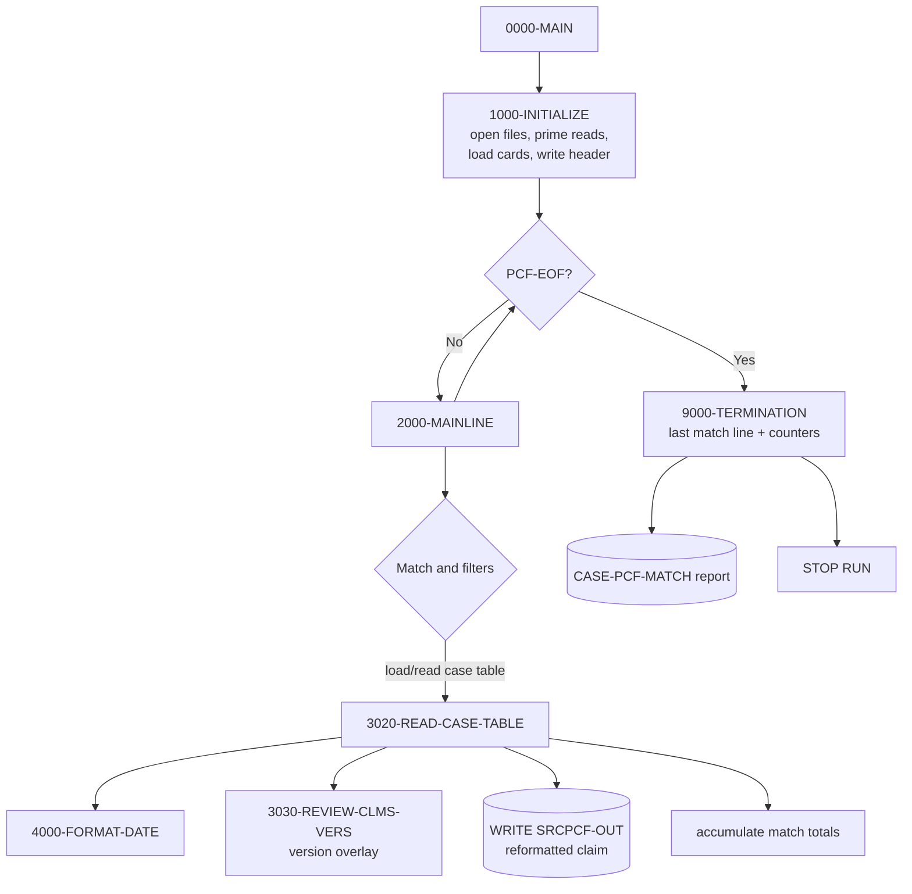
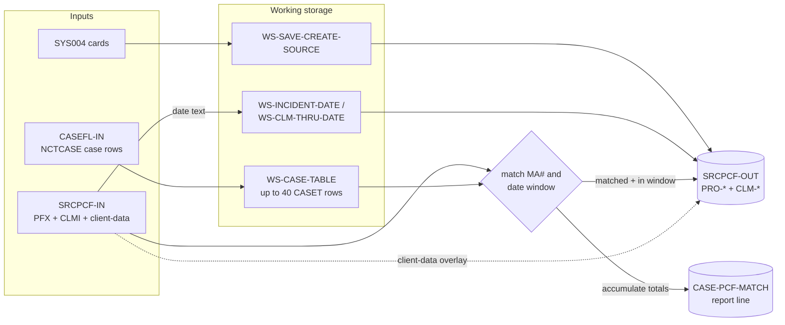
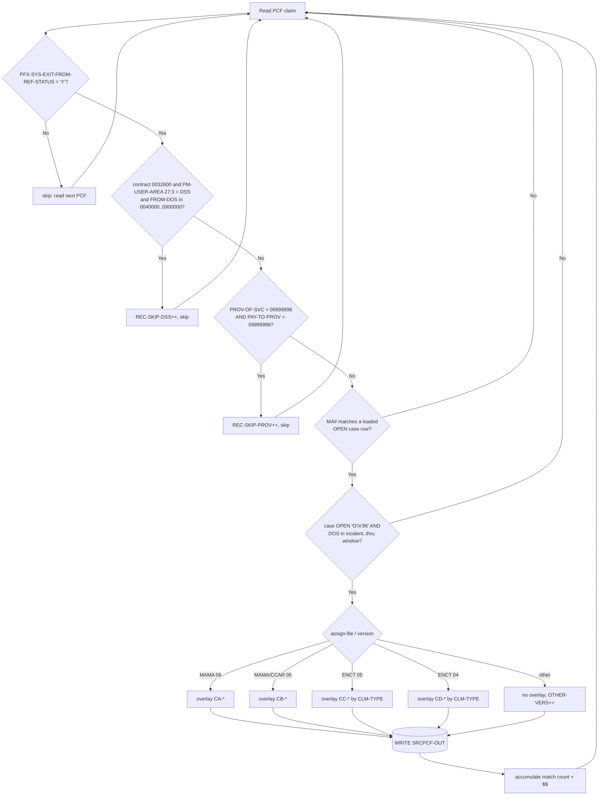

# CASPCFNJ — Comprehensive Field-Mapping Analysis

> **Scope & evidence note.** This analysis is built **only** from the real COBOL
> source in this repository, `CASPCFNJ` (1,720 lines). Every mapping cites a
> source line number (shown as `Lnnn`). The program `COPY`s its record layouts
> from external copybooks that are **not present in this repository**
> (`TPLPREFX`, `FDPCF602`, `FDPCF601`, `CLMPREFX`, `NCTCASE`, `FDNJTPC5`,
> `FDNJTPC4`, `FDNJ5INS`, `FDNJ4INS`). Consequently, exact `PICTURE` clauses and
> byte offsets for the `PFX-/CLMI-/PRO-/CLM-` fields cannot be read from source.
> Where a picture can be *inferred* from how the field is used it is marked
> `[inf]`; otherwise it is reported as a gap rather than guessed (see §14). The
> second output file (the match report) **is** fully defined inside the program,
> so its fields carry exact pictures and byte positions.

Companion workbook: **`CASPCFNJ_1x1_Field_Mapping.xlsx`** (4 sheets) — generated
by **`build_field_mapping_xlsx.py`** in this folder.

---

## 1. Overview and purpose

`CASPCFNJ` (`PROGRAM-ID. CASPCFNJ`, L2) **extracts PCF claim data based on case
data from the CAS2000 system** (program abstract, L7–L11). It is a clone of
`CASPCFDA` and an updated version of `CASPCFM1` (L11, L17). The July‑2025 change
header (L18–L19, `CHG2724516` / `CUS0136047 – CTSCASNJ – MAINFRAME CLAIM PULL`)
identifies it as the New Jersey claim‑pull variant.

**Program role:** *Reformat + Filter + Multi‑output.*

* **Reformat** — the input claim body is `HMS-600` (`FDPCF602`, prefix `CLMI`),
  the output claim body is `HMS-601` (`FDPCF601`, prefix `CLM`). The layouts are
  almost identical, but `HMS-601` has an **enlarged diagnosis-code area**, so the
  whole-record group move is commented out (L570) and the program moves
  **field by field** (L572–L704).
* **Filter** — claims are skipped on ref-status, a DSS date window, and a dummy
  provider number (§12).
* **Multi-output** — it writes a reformatted **claim file** and a **match
  report** file.

The program matches each PCF claim to **open** CAS2000 case rows by Medicaid
number and a date-of-service window, reformats the matched claim, writes it to
the claim output, and accumulates a per‑case match/dollar summary for the report.

---

## 2. Inputs reviewed

| Artifact | In repo? | Role |
|---|---|---|
| `CASPCFNJ` (COBOL program) | ✅ Yes | The analyzed program |
| `TPLPREFX` → `PFX-*` | ❌ No | Claim input **prefix / key** area (L154) |
| `FDPCF602` → `CLMI-*` | ❌ No | Claim input **body** `HMS-600` (L157) |
| `CLMPREFX` → `PRO-*` | ❌ No | Claim output **prefix / key** area (L218) |
| `FDPCF601` → `CLM-*` | ❌ No | Claim output **body** `HMS-601` (L224) |
| `NCTCASE` → `CASE-*`,`CASET-*` | ❌ No | Case file + 40-row case table (L145, L211) |
| `FDNJTPC5` → `CA-*` | ❌ No | Client-data overlay, MAMA v06 (L199) |
| `FDNJTPC4` → `CB-*` | ❌ No | Client-data overlay, MAMA/CCAR v05 (L201) |
| `FDNJ5INS` → `CC-*` | ❌ No | Client-data overlay, ENCT v05 (L203) |
| `FDNJ4INS` → `CD-*` | ❌ No | Client-data overlay, ENCT v04 (L205) |
| Control file `SYS004` (`CNTL-CARDS`) | n/a (runtime) | Card tag `1` supplies create-source (L422–L430) |

Commented-out copybooks (not active): `FDNMINS*`, `FDNMMED*`, `FDNMRX*`,
`FDNMADJ*`, `FDPCF600` (L163–L221) — the version-1/2/3/4 processing paragraphs
that consumed them are entirely commented out (L1004–L1517).

---

## 3. Program architecture and flow

Driver `0000-MAIN` (L359–L366):

```
PERFORM 1000-INITIALIZE
PERFORM 2000-MAINLINE UNTIL PCF-EOF
PERFORM 9000-TERMINATION
STOP RUN
```

Key paragraphs (active):

| Paragraph | Lines | Responsibility |
|---|---|---|
| `1000-INITIALIZE` | 370–393 | Open files, read first PCF + case, read all control cards, init table, write match header |
| `1500-READ-SRCPCF-IN` | 397–404 | Read PCF claim `INTO WS-CLMI-RECORD`; set `PCF-EOF` |
| `1600-READ-CASEFL-IN` | 408–418 | Read case `INTO WS-CASE-RECORD`; count open cases |
| `1650-READ-CARDS` | 422–433 | Read `SYS004` cards; card tag `1` → `WS-SAVE-CREATE-SOURCE` |
| `1700-WRITE-MATCH-HEADER` | 435–441 | Write report header row(s) |
| `2000-MAINLINE` | 443–507 | Merge/match logic + skip filters; drives table load/read |
| `3000-INITIALIZE-TABLE` | 511–516 | `INITIALIZE WS-CASE-TABLE(SUB-I)` |
| `3010-LOAD-CASE-TABLE` | 518–530 | Load up to 40 case rows for one MA number |
| `3020-READ-CASE-TABLE` | 532–748 | **Core reformat + write** (date gate, PRO/CLM moves, write) |
| `3030-REVIEW-CLMS-VERS` | 750–979 | Version-based diagnosis/procedure overlay |
| `4000-FORMAT-DATE` | 981–1002 | Build incident/thru dates from case text |
| `5500-PROCESS-RECS` | 1518–1523 | “Other version” counter only |
| `2100-WRITE-CASE-PCF-MATCH` | 1525–1552 | Write one report line per matched CASE-ID |
| `9000-TERMINATION` | 1554–1705 | Final match line, counters, close files |
| `9100-WRITE-MATCH-TRAILER` | 1707–1718 | Report trailer / “no match” line |

### Overall flow (Mermaid)



---

## 4. Layout and copybook relationship

**Input claim record** `WS-CLMI-RECORD` (L152–L159) is three pieces:

1. `COPY TPLPREFX` → `PFX-*` — prefix/key area (comment “1ST 127”, L153).
2. `02 CLMI-HMS-600` `COPY FDPCF602` → `CLMI-*` — claim body (“2ND 600”, L156).
3. `02 CLMI-CLIENT-DATA PIC X(32025)` — client-side remainder, later re-mapped
   through version copybooks.

**Output claim record** `WS-SRCPCF-OUT` (L217–L224):

1. `COPY CLMPREFX` → `PRO-*` — output prefix/key area.
2. `03 CLM-HMS-601` `COPY FDPCF601` → `CLM-*` — output body (enlarged diag area).

`FD` record lengths (L40–L71): `CLMI-RECORD` `PIC X(32752)` (VB 4–32752),
`CASE-RECORD` `PIC X(384)`, `CLMO-RECORD` `PIC X(754)`, `MATCH-RECORD` `PIC X(80)`.

Relationship summary: **input and output claim layouts are *different but
parallel*** — same field set with a renamed prefix (`CLMI→CLM`), plus a prefix
key block that is populated from case + prefix data (`PRO-*`). This is why the
program is a **reformat**, not a passthrough.

---

## 5. Input formats

There is **one physical PCF input format** (`SRCPCF-IN`), but the `CLMI-CLIENT-DATA`
remainder is re-interpreted into **four logical client formats** selected by
`PFX-SYS-HMS-ASSIGN-FILE` + `PFX-SYS-VERSION` in `3030-REVIEW-CLMS-VERS`:

| Assign file | Version | Overlay record | Prefix | Lines |
|---|---|---|---|---|
| `MAMA` | `06` | `INST-RECA` (`FDNJTPC5`) | `CA-` | 764–789 |
| `MAMA` or `CCAR` | `05` | `CB-CLMS-ACTIVITY-RECORD` (`FDNJTPC4`) | `CB-` | 791–817 |
| `ENCT` | `05` | `INST-RECC` (`FDNJ5INS`) | `CC-` | 819–892 |
| `ENCT` | `04` | `CD-ENC-ACTIVITY-RECORD` (`FDNJ4INS`) | `CD-` | 895–969 |
| anything else | — | none (count only) | — | 970–972, 5500 |

A second input, the case file `CASEFL-IN`, uses the single `NCTCASE` layout
(single row `CASE-*`, table row `CASET-*`). A third input, `SYS004` control
cards, uses `CARD-REC` (L237–L242).

---

## 6. Output layouts and write paths

| Output file | DD | Rec | Written from | Where |
|---|---|---|---|---|
| **Claim** `SRCPCF-OUT` | `SRCPCFO` | FB 754 (`CLMO-RECORD`) | `WS-SRCPCF-OUT` (`PRO-*` + `CLM-*`) | L732 inside `3020` |
| **Match report** `CASE-PCF-MATCH` | `MATCHO` | FB 80 (`MATCH-RECORD`) | `WS-MATCH-OUT` | L437/439 header, L1547 per case, L1711/1714/1716 trailer |

**Claim write path:** exactly **one** claim record is written per PCF input that
(a) matches an open case row and (b) falls inside the date window (L732). A
single PCF claim can, in principle, be written once per matching case row in the
loaded table (`3020` VARYING `SUB-I`, L495–L504).

**Match report write path:** one summary line per **matched CASE-ID** (not per
claim), emitted when the next CASE-ID starts (L480–L484) or at termination
(L1557–L1560), bracketed by a header (L435–L439) and trailer (L1707–L1718).

The match record (80 bytes) is fully program-defined (`WS-MATCH-OUT`, L226–L235):

| Field | PIC | Bytes | Header literal | Per-case value |
|---|---|---|---|---|
| `F` (FILLER) | X(3) | 1–3 | `' * '` | — |
| `MATCH-CASE-ID-OUT` | X(20) | 4–23 | `'CASE ID'` | `WS-CASE-ID` (L1527) |
| `F` (FILLER) | X(3) | 24–26 | `' * '` | — |
| `MATCH-TOT-PCF-REC-OUT` | X(19) | 27–45 | `'PCF RECORDS MATCHED'` | `WS-TOT-PCF-REC-MATCH` edited (L1529–1534) |
| `F` (FILLER) | X(3) | 46–48 | `' * '` | — |
| `MATCH-TOT-PCF-MA-PAID-OUT` | X(18) | 49–66 | `'PCF TOT $$ MA PAID'` | `WS-TOT-PCF-MA-PAID` edited (L1536–1541) |
| `F` (FILLER) | X(2) | 67–68 | `' *'` | — |
| *(implicit)* | X(12) | 69–80 | spaces (80-byte WRITE) | — |

### Input-to-output flow (Mermaid)



---

## 7. Mapping methodology

For every output field the source was traced from the `WRITE` target
(`WS-SRCPCF-OUT` / `WS-MATCH-OUT`) back through `MOVE`/`PERFORM` to the
elementary source, resolving:

* **Working-storage intermediaries** — e.g. `PRO-INCIDENT-DATE` ← `WS-INCIDENT-DATE`
  ← `UNSTRING CASET-INCIDENT-DATE` (L562, L985–L991).
* **`PERFORM VARYING` subscripts** — the claim is evaluated against each loaded
  case row `CASET-*(SUB-I)` (L495–L504); `PRO-HMS-CASE-KEY` ← `CASET-HMS-CASE-KEY(SUB-I)`.
* **Conditional overlays** — diagnosis/procedure fields have a **base** move in
  `3020` and a **version override** in `3030`.

Each output field is then classified as exactly one of: *1:1 direct (renamed),
direct from case table, direct from control card, derived/transformed,
crosswalk/version-translated, hardcoded constant, default SPACES/ZEROS,* or
*not populated*. The full classification is in **Sheet 1** of the workbook.

Field-count summary (Sheet 1 = **125** output-field rows):

| Group | Count |
|---|---|
| `PRO-*` output prefix fields | 11 |
| `CLM-*` output body fields (base moves) | 106 |
| `CLM-CDE-ICD-VERSION` (constant, date-derived) | 1 |
| `CASE-PCF-MATCH` report fields | 7 |
| **Total** | **125** |

---

## 8. Field-level behavior (base rules + per-path overrides)

**Base rule — claim body (`CLM-*`).** 100+ fields are plain **1:1 direct moves**
`CLMI-x → CLM-x` (L572–L704), e.g. `CLM-PAT-LAST-NAME ← CLMI-PAT-LAST-NAME`
(L590). For a direct move the output value equals the input value.

**Base rule — output prefix (`PRO-*`).** Populated from claim keys, the matched
case row, the control card, and derived dates (L543–L563):

| Target | Source | Type | Line |
|---|---|---|---|
| `PRO-RECIPIENT-ID-NUM` | `CLMI-PCF-MA-NUM` | direct | 543 |
| `PRO-HMS-CASE-KEY` | `CASET-HMS-CASE-KEY(SUB-I)` | case table | 544 |
| `PRO-CLIENT-ID` | `CASET-HMS-CLIENT-ID(SUB-I)` | case table | 546 |
| `PRO-CREATE-SOURCE` | `WS-SAVE-CREATE-SOURCE` (card) | control card | 552 |
| `PRO-ICN` | `CLMI-ICN` (+suffix reformat) | direct / override | 554, 717 |
| `PRO-FORMER-ICN` | `CLMI-FORMER-ICN` | direct | 555 |
| `PRO-XACTION-STATUS` | `CLMI-XACTION-STATUS` | direct | 556 |
| `PRO-CLM-FROM-DATE` | `PFX-APP-DATE-OF-SERVICE` | direct | 558 |
| `PRO-CLAIM-TRANS-TYPE` | `PFX-NET-CLAIM-TRANS-TYPE` | direct | 560 |
| `PRO-INCIDENT-DATE` | `CASET-INCIDENT-DATE(SUB-I)` | derived | 562 |
| `PRO-CLM-THRU-DATE` | `CASET-CLAIMS-THRU-DATE(SUB-I)` | derived | 563 |

**Per-path overrides** (8 diagnosis/procedure fields) — base move in `3020`,
then conditionally overwritten in `3030` based on client format/version:
`CLM-PROCEDURE-CODE-7`, `CLM-PROCEDURE-CODE-MOD1/2`, `CLM-PRI-DX`, `CLM-SEC-DX`,
`CLM-DX-3`, `CLM-DX-4`, `CLM-DX-5`. See §10 and **Sheet 2**.

**Size-changing direct move.** `CLM-PROCEDURE-CODE-7 ← CLMI-PROCEDURE-CODE-5`
(L574) copies a 5-char source into a 7-char target `[inf]`.

**Conditional source swap.** `CLM-PROV-OF-SVC-NUM`: if the input prov-of-svc is
the dummy `'09999996'` **and** contract is `'0032600'`, the source is first
replaced by `CLMI-PAY-TO-PROV-NUM` (L564–L568) before the move at L573.

---

## 9. Initialization and defaulting (SPACES, ZEROS, constants)

* `WS-COUNTERS` is `INITIALIZE`d to zeros (L379); `WS-CASE-TABLE(SUB-I)` is
  `INITIALIZE`d before load (L513).
* `PRO-CLMPRFX` is `INITIALIZE`d before each claim is built (L542), so any
  `PRO-*`/`CLM-*` field **not** otherwise moved defaults to SPACES/ZEROS per its
  copybook type.
* **Procedure-code modifiers forced to SPACES** on every version overlay
  (`MOVE SPACES TO CLM-PROCEDURE-CODE-MOD1/MOD2`, e.g. L782–L783, L810–L811,
  L890–L891, L967–L968).
* **Constants:** `CLM-CDE-ICD-VERSION` ← `'09'`/`'10'` (L727/L729); the match
  header literals `'CASE ID'`, `'PCF RECORDS MATCHED'`, `'PCF TOT $$ MA PAID'`,
  and separators `' * '` (L227–L235); trailer `'NO MATCHED PCF RECORDS FOUND'`
  (L1710) and `ALL '*'` (L1715).
* **Default date:** `WS-CLM-THRU-DATE` ← `'99999999'` when the case thru-date is
  blank (L999); incident day-of-month forced to `01` (L991).

---

## 10. Transformation and crosswalk logic

**Date reformat (derived).**
`4000-FORMAT-DATE` (L981–L1002) `UNSTRING`s the case text dates:

* `CASET-INCIDENT-DATE` “`YYYY-MM`” → `WS-IN-YYYY`,`WS-IN-MM`; day set to `01`
  (L985–L991) → `PRO-INCIDENT-DATE`.
* `CASET-CLAIMS-THRU-DATE` “`YYYY-MM-DD`” → `WS-THRU-*`, else `'99999999'`
  (L993–L999) → `PRO-CLM-THRU-DATE`.

**ICN suffix reformat (derived).** When `CLMI-PM-USER-AREA(1:2)` ∈ {`PB`,`DT`},
contract `'0032600'`, `PM-USER-AREA(27:3) ≠ 'DSS'`, and the ICN suffix is numeric
non-zero, the ICN is rebuilt as 17-byte ICN ‖ 2-byte suffix via
`WS-ICN-GROUP-19` and moved to **both** `PRO-ICN` and `CLM-ICN` (L706–L723).

**ICD version constant (derived).** After the version overlay, L726–L730 sets
`CLM-CDE-ICD-VERSION` = `'09'` when `PRO-CLM-FROM-DATE < 20151001`, else `'10'`.
Because this runs **after** `3030`, the date rule always wins.

**Version crosswalk (diagnosis / procedure).** `3030-REVIEW-CLMS-VERS` overlays
diagnosis and procedure codes from the re-interpreted client-data record:

* **MAMA v06 → `CA-`** (L764–L789): `CA-A-PROC-CDE` → `CLM-PROCEDURE-CODE-7`;
  `CA-A-DIAG-CDE(1..5)` → `CLM-PRI-DX,SEC-DX,DX-3,DX-4,DX-5`; MOD1/MOD2 = SPACES.
* **MAMA/CCAR v05 → `CB-`** (L791–L817): analogous using `CB-A-PROC-CDE` /
  `CB-A-DIAG-CDE(1..5)`.
* **ENCT v05 → `CC-`** (L819–L892): diagnosis source chosen by `CLMI-CLM-TYPE`
  via `EVALUATE` (WHEN `01,02,03,04,06,07,18`) across
  `CC-HNI/OP/PR/HH/TR/VI-DIAG`; type `02` prefers `HNI`, falls back to `OP`;
  `CC-E-PROC-CDE` → procedure code for `CLM-TYPE ≠ '12'`.
* **ENCT v04 → `CD-`** (L895–L969): same shape with `CD-*`.
* **Any other** file/version (L970–L972): `5500-PROCESS-RECS` only
  `ADD 1 TO OTHER-VERS`; the base `CLMI→CLM` diagnosis/procedure values are kept.

**Report edits (derived).** `WS-TOT-PCF-REC-MATCH` → `ZZZZ9` then space-trimmed
into `MATCH-TOT-PCF-REC-OUT` (L1529–1534); `WS-TOT-PCF-MA-PAID` →
`$$$,$$$,$$$,$$9.99` then trimmed into `MATCH-TOT-PCF-MA-PAID-OUT` (L1536–1541).

### Routing / decision tree (Mermaid)



---

## 11. Dependencies (copybooks, called programs)

* **Copybooks (active):** `TPLPREFX`, `FDPCF602`, `CLMPREFX`, `FDPCF601`,
  `NCTCASE`, `FDNJTPC5`, `FDNJTPC4`, `FDNJ5INS`, `FDNJ4INS` (see §2). None are in
  this repository.
* **Copybooks (commented-out / inactive):** `FDPCF600`, `FDNMINS1–4`,
  `FDNMMED1–4`, `FDNMRX1–4`, `FDNMADJ1–4` (L163–L221).
* **Called programs:** none. There is **no `CALL`** statement; all logic is
  in-line `PERFORM`. The only external interactions are file I/O and `DISPLAY`.
* **Files / DD names:** `SRCPCFI`, `CASEFLI`, `SYS004`, `SRCPCFO`, `MATCHO`
  (L25–L29).

---

## 12. Skip / reject / stop / abend conditions

| # | Condition | Action | Lines |
|---|---|---|---|
| Ref-status | `PFX-SYS-EXIT-FROM-REF-STATUS NOT = 'Y'` | read next PCF, **skip** (no write) | 452–455 |
| DSS window | contract `'0032600'` **and** `PM-USER-AREA(27:3)='DSS'` **and** `CLAIM-FROM-DOS > 0040000` **and** `< 0900000` | `ADD 1 REC-SKIP-DSS`, skip | 457–469 |
| Dummy provider | `PROV-OF-SVC-NUM='09999996'` **and** `PAY-TO-PROV-NUM='09999996'` | `ADD 1 REC-SKIP-PROV`, skip | 471–476 |
| Case not open | `CASET-CASE-STATUS-CODE` ≠ `'O'`/`X'96'` | not written | 537–538 |
| Out of window | DOS `< WS-INCIDENT-DATE-NEW-RE` or `> WS-CLM-THRU-DATE-N` | not written | 540–541 |
| Recipient skip | `CASE-RECIPIENT-ID-NUM < PFX-APP-MEDICAID-NO` | advance case file | 445–448 |
| SIZE ERROR | `ADD` overflow on match count / `$$` paid | set `SIZE-ERROR`; report line shows `'TOO MANY MATCHES, $$ PAID NOT AVAILABLE !'` | 737–740, 1542–1545 |
| **Stop** | normal end only | `STOP RUN` | 365 |
| **Abend** | *none* | — the program has no `ABEND`/`GOBACK`-on-error path | — |

---

## 13. Worked example (from Sheet 4)

A single consistent scenario — a **MAMA v06** claim matching an **open** case.

**Inputs**

* **Control card** `SYS004`: `CARD-TAG='1'`, `CARD-DATA='NJ'` → `WS-SAVE-CREATE-SOURCE='NJ'` (L430).
* **Case row** (`NCTCASE`): `CASE-RECIPIENT-ID-NUM='123456789012'`, status `'O'`,
  `CASET-HMS-CASE-KEY='CASEKEY0001'`, `CASET-HMS-CLIENT-ID='CLIENT0001'`,
  `CASET-INCIDENT-DATE='2024-01'`, `CASET-CLAIMS-THRU-DATE='2024-12-31'`.
* **PCF claim:** `PFX-APP-MEDICAID-NO='123456789012'`, `PFX-SYS-EXIT-FROM-REF-STATUS='Y'`,
  `PFX-APP-DATE-OF-SERVICE='20240115'`, `PFX-SYS-HMS-ASSIGN-FILE='MAMA'`,
  `PFX-SYS-VERSION='06'`, `CLMI-PCF-MA-NUM='123456789012'`,
  `CLMI-ICN='20240011122233300'`, `CLMI-CLM-TYPE='01'`,
  `CLMI-PCF-CONTRACT-NUM='0032600'`, `CLMI-PROV-OF-SVC-NUM='01234567'`,
  `CLMI-TOT-MA-PAID-HDR=000000150.00`; client-data `CA-A-PROC-CDE='99213'`,
  `CA-A-DIAG-CDE(1..5)='4019','2724','E785','Z00','I10'`.

**Processing:** ref-status `'Y'` (pass L452); not DSS; provider not dummy; MA#
matches an open case; DOS `20240115` ∈ `[20240101 .. 20241231]` (L540–541);
MAMA/06 ⇒ `CA` overlay (L764–789).

**Output 1 — `SRCPCF-OUT` (key fields):**

| Target | Value | Rule |
|---|---|---|
| `PRO-RECIPIENT-ID-NUM` | `123456789012` | direct L543 |
| `PRO-CREATE-SOURCE` | `NJ` | card, L552 |
| `PRO-HMS-CASE-KEY` | `CASEKEY0001` | L544 |
| `PRO-CLIENT-ID` | `CLIENT0001` | L546 |
| `PRO-ICN` | `20240011122233300` | L554 (no suffix reformat: contract matches but `PM-USER-AREA` not `PB/DT` here) |
| `PRO-CLM-FROM-DATE` | `20240115` | L558 |
| `PRO-INCIDENT-DATE` | `20240101` | reformat L562/985–991 |
| `PRO-CLM-THRU-DATE` | `20241231` | reformat L563/993–999 |
| `CLM-PROCEDURE-CODE-7` | `99213` | CA overlay L781 |
| `CLM-PROCEDURE-CODE-MOD1/2` | spaces | L782–783 |
| `CLM-PRI-DX … CLM-DX-5` | `4019,2724,E785,Z00,I10` | CA overlay L784–788 |
| `CLM-CDE-ICD-VERSION` | `10` | `20240115 ≥ 20151001` → `'10'` (L729) |
| `CLM-TOT-MA-PAID-HDR` | `000000150.00` | direct L625 |

**Output 2 — `CASE-PCF-MATCH` line:**
`* 123456789012 * 1 * $150.00 *` — `MATCH-CASE-ID-OUT='123456789012'` (bytes 4–23),
`MATCH-TOT-PCF-REC-OUT='1'` (27–45), `MATCH-TOT-PCF-MA-PAID-OUT='$150.00'`
(49–66), with the total paid summed from `CLMI-TOT-MA-PAID-HDR` (L739).

---

## 14. Gaps, assumptions, and risks

1. **Copybooks absent (primary gap).** `TPLPREFX`, `FDPCF602`, `FDPCF601`,
   `CLMPREFX`, `NCTCASE`, and the four `FDNJ*` overlays are not in the repo.
   Therefore:
   * Exact **`PICTURE`** and **byte offsets** of `PFX-/CLMI-/PRO-/CLM-` fields
     are unknown; shown as `n/a (… copybook not in repo)` or inferred `[inf]`.
   * Output fields that are **defined in `FDPCF601`/`CLMPREFX` but never
     referenced in code cannot be enumerated** here. Sheet 1 lists **every output
     field that the program actually touches** (125 rows). The `PRO-*`+`CLM-*`
     body is written from `WS-SRCPCF-OUT`, so any copybook field not moved is
     emitted as its initialized default (§9). To make Sheet 1 a byte-complete
     master list, add `FDPCF601` and `CLMPREFX` to the repo and re-run the
     generator.
2. **Inferred pictures** (`[inf]`) are deductions from usage (literal
   comparisons, fixed-size WS fields), not copybook facts — e.g. dates `9(8)`,
   ICD version `X(2)`, diagnosis `X(7)` (from `WS-…-DIAG-CD-3-4 PIC X(7)`),
   `CLAIM-FROM-DOS` `9(7)` `0yymmdd` (from the L459–465 comment).
3. **Sample data is illustrative.** Values are realistic for the inferred
   type/length and kept consistent across the worked example, but are **not**
   taken from production data.
4. **Observations in the source (not changed by this analysis):**
   * ENCT v05/v04 type `01` moves `…-DIAG(4)` to `CLM-DX-4` twice and never sets
     `CLM-DX-5` (L827–828, L903–904); type `02` maps `…-DIAG(3)`→`CLM-DX-5`
     (L852, L928); ENCT v04 type `04` skips `CLM-SEC-DX` (L942–945). These look
     like latent source bugs but are reported **as-is**.
   * `VER-*` institutional/prof/rx/adj counters are displayed at termination but
     the paragraphs that incremented them are commented out (L1004–L1517), so
     they always display zero except `OTHER-VERS`.
5. **Repository mismatch.** The prompt header names repo
   `MallikarjunBJ/CCDB-REFORMAT`; this analysis was run against the actual
   repository that contains `CASPCFNJ` (`swatisable/Mainframe`). Outputs were
   committed to the folder holding `CASPCFNJ` (repository root).

---

## 15. Conclusion

`CASPCFNJ` is a **reformat + filter + multi-output** claim-extract program. It
matches PCF claims to **open** CAS2000 cases by Medicaid number and a
date-of-service window, reformats the `HMS-600` claim body into the enlarged
`HMS-601` layout (**field-by-field**, because the diagnosis area grows), overlays
diagnosis/procedure codes per client format/version, and writes a reformatted
**claim file** plus a per-case **match report**. The field-level mapping is
dominated by **1:1 direct moves** (`CLMI→CLM`), with a small, well-contained set
of **derived** fields (dates, ICN suffix, ICD version) and **version
crosswalks** (diagnosis/procedure). All 125 output fields the program touches are
enumerated and classified in `CASPCFNJ_1x1_Field_Mapping.xlsx`. The one material
limitation is the **absence of the copybooks**, which blocks exact pictures,
byte positions, and enumeration of never-referenced output fields; adding those
copybooks and re-running the generator would close that gap.

---

### Final checklist

- [x] Program role and layout relationship stated (§1, §4)
- [x] Workbook has exactly 4 sheets
- [x] Every output field the program touches appears as a row (125)
- [x] Every field is classified (Sheet 1 “Mapping Type”)
- [x] Working-storage chains and loop subscripts resolved (§7, §10)
- [x] Separate columns for each output path (Sheet 1) + per-format overrides (Sheet 2)
- [x] Every field has sample input/output values (illustrative, marked)
- [x] At least one full sample record per input format (Sheet 4 + §13; other formats in Sheet 2)
- [x] Overrides and crosswalks listed in Sheet 2
- [x] Skip/reject/abend conditions documented (§12, Sheet 3)
- [x] Exact field names used from the source; PIC clauses given where in-program, otherwise flagged as copybook gaps
