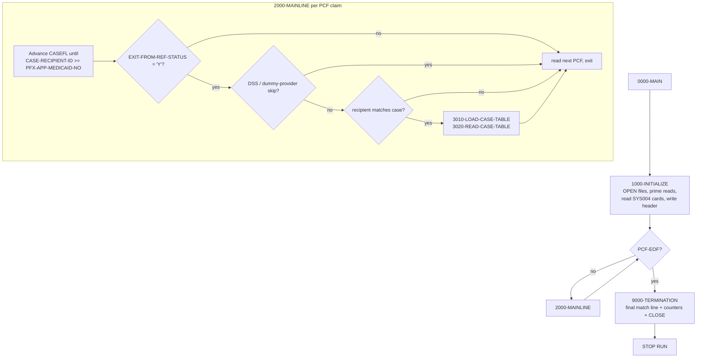
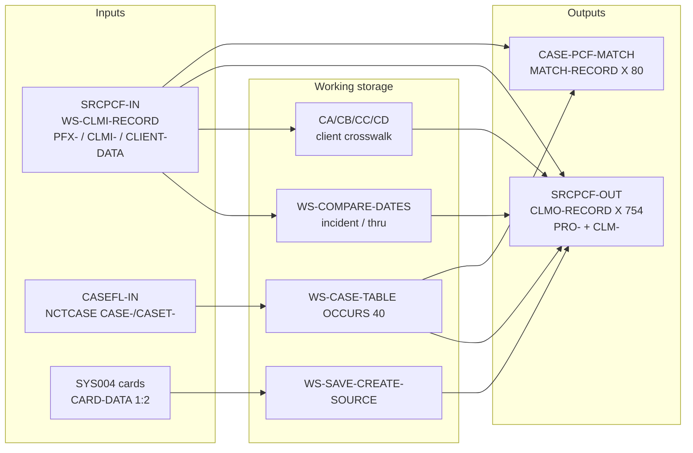
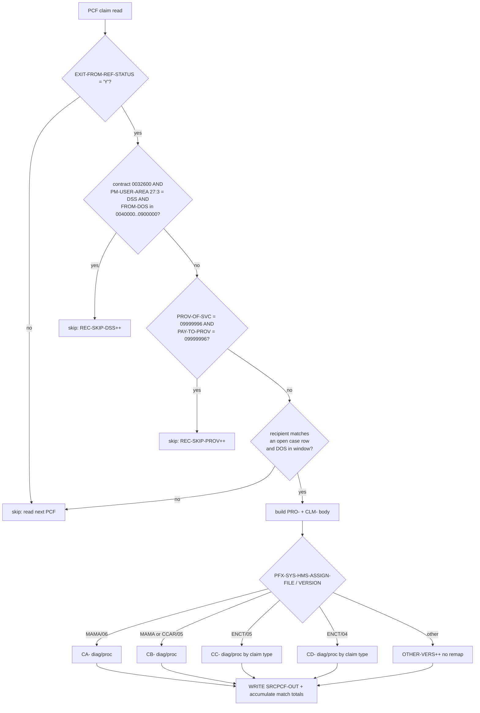

# CASPCFNJ — Comprehensive Field-Mapping Analysis

*Program:* **CASPCFNJ**  ·  *Repository:* **swatisable/Mainframe**  ·  *Folder:* repository root
*Companion workbook:* [`CASPCFNJ_1x1_Field_Mapping.xlsx`](./CASPCFNJ_1x1_Field_Mapping.xlsx)
*Workbook generator:* [`CASPCFNJ_build_mapping.py`](./CASPCFNJ_build_mapping.py)

> **Evidence rule.** Every mapping in this report and in the workbook is anchored to a real
> line of `CASPCFNJ` (shown as `L####`) or to a real copybook field named in the code.
> Items that cannot be confirmed from the repository are tagged **`[UNCERTAIN]`** with the reason.
>
> **Key limitation (read first).** The program is present but **its copybooks are not in this
> repository** (`CLMPREFX`, `FDPCF601`, `FDPCF602`, `TPLPREFX`, `NCTCASE`, `FDNJTPC5`, `FDNJTPC4`,
> `FDNJ5INS`, `FDNJ4INS`, …). Consequently, exact **PICTURE clauses and byte offsets** for the
> `PRO-*` (CLMPREFX) and `CLM-*` (FDPCF601) fields **cannot be read** and are marked `[UNCERTAIN]`.
> The `CASE-PCF-MATCH` report record **is defined inline** in the program, so its fields carry
> **exact** PICs and byte positions. All claim sample values are *illustrative*.

---

## 1. Overview and purpose

`CASPCFNJ` is a batch COBOL extract that **pulls PCF (Paid Claim File) claim records that match
open CAS2000 case records** and writes a reformatted claim extract plus a case/claim match report.
The program abstract states it "extracts PCF claim data based on case data from CAS2000 system" and
that it is a **clone of `CASPCFDA`** and an **updated version of `CASPCFM1`** (`L7-19`). The most
recent modification is `CHG2724516 / CUS0136047 – CTSCASNJ – MAINFRAME CLAIM PULL` dated 07/21/2025
(`L17-19`).

**Program role:** **Reformat + Filter/Matcher, Multi-output.**
* *Reformat* — the input claim HMS area (`FDPCF602`, "600" area) is copied field-by-field into a
  **different**, larger output claim area (`FDPCF601`, "601" area with enlarged diagnosis codes).
  The whole-record bulk move is deliberately disabled (`L569-570` comment:
  `* IN PLACE OF THIS MOVE WE MOVE THE RECORD BY COLUMN`) and replaced by ~106 column moves.
* *Filter/Matcher* — only PCF claims that match an **open** case and fall inside the case service
  window are written; several categories are explicitly skipped.
* *Multi-output* — it writes **two** files: the claim extract `SRCPCF-OUT` and the match report
  `CASE-PCF-MATCH`.

**Bulk-move length:** none active. The claim body is moved **column by column** (`L572-704`);
the single bulk `MOVE CLMI-HMS-600 TO CLM-HMS-601` is commented out (`L570`) because the output
diagnosis fields are wider than the input.

---

## 2. Inputs reviewed (program, copybooks, control files)

| Artifact | In repo? | Role | Evidence |
|---|---|---|---|
| `CASPCFNJ` (program) | ✅ yes | The analyzed program | whole file |
| `TPLPREFX` copybook | ❌ no | Input claim **prefix** (`PFX-`), "1st 127" area | `L154` |
| `FDPCF602` copybook | ❌ no | Input claim **HMS-600** body (`CLMI-`) | `L157` |
| `NCTCASE` copybook | ❌ no | Case record / case table (`CASE-`, `CASET-`) | `L145, L211` |
| `CLMPREFX` copybook | ❌ no | Output claim **prefix** (`PRO-`) | `L218` |
| `FDPCF601` copybook | ❌ no | Output claim **HMS-601** body (`CLM-`) | `L224` |
| `FDNJTPC5` copybook | ❌ no | Client data v06 MAMA (`CA-`) crosswalk | `L199` |
| `FDNJTPC4` copybook | ❌ no | Client data v05 MAMA/CCAR (`CB-`) crosswalk | `L201` |
| `FDNJ5INS` copybook | ❌ no | Client data v05 ENCT (`CC-`) crosswalk | `L203` |
| `FDNJ4INS` copybook | ❌ no | Client data v04 ENCT (`CD-`) crosswalk | `L205` |
| `FDNMINS3/2`, `FDNMMED3/2`, `FDNMRX3/2`, `FDNMADJ3/2` | ❌ no | Legacy client copybooks (used only by **commented-out** `5100-*` paragraphs) | `L165-192` |
| `SYS004` control cards | runtime | Supplies `CREATE-SOURCE` (card tag `'1'`) | `L29, L422-430` |

**Files (FILE-CONTROL / FD):**

| Logical file | DDNAME | Mode | Record (01) | Size | Evidence |
|---|---|---|---|---|---|
| `SRCPCF-IN` (input) | `SRCPCFI` | VB, 4–32752, `DEPENDING ON PCF-DEP` | `CLMI-RECORD` | `X(32752)` | `L25, L40-47` |
| `CASEFL-IN` (input) | `CASEFLI` | FB | `CASE-RECORD` | `X(384)` | `L26, L50-55` |
| `CNTL-CARDS` (input) | `SYS004` | FB | `CNTL-REC` | `X(80)` | `L29, L34-38` |
| `SRCPCF-OUT` (output) | `SRCPCFO` | FB | `CLMO-RECORD` | `X(754)` | `L27, L58-63` |
| `CASE-PCF-MATCH` (output) | `MATCHO` | FB | `MATCH-RECORD` | `X(80)` | `L28, L66-71` |

---

## 3. Program architecture and flow

The driver `0000-MAIN` (`L359-366`) runs init → mainline-loop (until PCF end-of-file) → termination:

```
0000-MAIN
  PERFORM 1000-INITIALIZE
  PERFORM 2000-MAINLINE UNTIL PCF-EOF
  PERFORM 9000-TERMINATION
  STOP RUN
```

**Paragraph map (active code):**

| Paragraph | Lines | Responsibility |
|---|---|---|
| `1000-INITIALIZE` | `L370-395` | OPEN files; `INITIALIZE WS-COUNTERS`; prime first PCF & case reads; read all control cards; init case table (30); write match header |
| `1500-READ-SRCPCF-IN` | `L397-406` | `READ SRCPCF-IN INTO WS-CLMI-RECORD`; set `PCF-EOF`; count reads |
| `1600-READ-CASEFL-IN` | `L408-420` | `READ CASEFL-IN INTO WS-CASE-RECORD`; count reads & open cases (status `'O'`/`X'96'`) |
| `1650-READ-CARDS` | `L422-433` | Read `SYS004`; card tag `'1'` → `WS-SAVE-CREATE-SOURCE = CARD-DATA(1:2)` |
| `1700-WRITE-MATCH-HEADER` | `L435-441` | Write report header line + blank line |
| `2000-MAINLINE` | `L443-509` | Catch up case file; apply skips; detect recipient match; load/scan case table; read next PCF |
| `3000-INITIALIZE-TABLE` | `L511-516` | `INITIALIZE WS-CASE-TABLE(SUB-I)` |
| `3010-LOAD-CASE-TABLE` | `L518-530` | Load all case rows for a recipient into `WS-CASE-TABLE` (OCCURS 40) |
| `3020-READ-CASE-TABLE` | `L532-748` | **Core mapping + write** of each matched open claim |
| `3030-REVIEW-CLMS-VERS` | `L750-979` | **Diagnosis/procedure crosswalk** by client file version & claim type |
| `4000-FORMAT-DATE` | `L981-1002` | Build incident / claims-thru dates from case text |
| `5500-PROCESS-RECS` | `L1518-1523` | Fallthrough counter (`OTHER-VERS + 1`) |
| `2100-WRITE-CASE-PCF-MATCH` | `L1525-1552` | Write a per-case detail line to the report |
| `9000-TERMINATION` | `L1554-1705` | Final match line; compute counters; `DISPLAY` stats; CLOSE files |
| `9100-WRITE-MATCH-TRAILER` | `L1707-1718` | Report trailer (`NO MATCHED…` / blank / `****`) |

> The `5100-*INST/PROF/RX/ADJ-PROCESS-RECS*` paragraphs (`L1004-1516`) are **entirely commented
> out** and do not execute. The live diagnosis/procedure logic is in `3030-REVIEW-CLMS-VERS`.

### Mermaid — overall control flow



---

## 4. Layout and copybook relationship

**Input claim area** `WS-CLMI-RECORD` (`L152-159`) is three concatenated pieces:

```
WS-CLMI-RECORD
├── COPY TPLPREFX  (PFX-)        "1st 127"   → prefix/control keys (PFX-APP-MEDICAID-NO, dates, status)
├── CLMI-HMS-600                 "2nd 600"
│     └── COPY FDPCF602 (CLMI-)              → the 600-byte HMS claim body
└── CLMI-CLIENT-DATA  PIC X(32025)           → client-specific remainder (re-mapped onto CA/CB/CC/CD)
```

**Output claim area** `WS-SRCPCF-OUT` (`L217-224`):

```
WS-SRCPCF-OUT
├── COPY CLMPREFX  (PRO-)                     → output prefix (recipient, case key, client id, dates…)
└── CLM-HMS-601
      └── COPY FDPCF601 (CLM-)                → the enlarged HMS claim body (wider diagnosis codes)
```

**Relationship:** input body `FDPCF602` and output body `FDPCF601` are **different layouts**
(the "601" variant enlarges diagnosis storage), which is exactly why the program copies
field-by-field instead of a single group move (`L569-570`). The **case** side uses one copybook,
`NCTCASE`, instantiated twice — once as the single read area `WS-CASE-RECORD` (`CASE-` prefix,
`L210-211`) and once as a 40-row table `WS-CASE-TABLE` (`CASET-` prefix, `L143-146`).

---

## 5. Input formats

There is **one physical input claim record**, but its `CLIENT-DATA` remainder is interpreted in
**four active client formats**, selected by `PFX-SYS-HMS-ASSIGN-FILE` + `PFX-SYS-VERSION`
(`3030-REVIEW-CLMS-VERS`):

| # | Assign file / version | Re-mapped onto | Copybook | Evidence |
|---|---|---|---|---|
| 1 | `MAMA` / `06` | `INST-RECA` (`CA-`) | `FDNJTPC5` | `L764-789` |
| 2 | `MAMA` or `CCAR` / `05` | `CB-CLMS-ACTIVITY-RECORD` (`CB-`) | `FDNJTPC4` | `L791-817` |
| 3 | `ENCT` / `05` | `INST-RECC` (`CC-`) | `FDNJ5INS` | `L819-892` |
| 4 | `ENCT` / `04` | `CD-ENC-ACTIVITY-RECORD` (`CD-`) | `FDNJ4INS` | `L895-969` |
| — | anything else | *(no re-map)* — `5500-PROCESS-RECS` counts `OTHER-VERS` | — | `L970-972, L1518-1520` |

The driver (`PFX-`) and HMS body (`CLMI-`) parts are the same across formats; only the diagnosis and
procedure codes are re-sourced per format (see §10). Two control inputs also shape processing:
the **case file** (`NCTCASE`) and the **SYS004 control cards** (card tag `'1'` → `CREATE-SOURCE`).

---

## 6. Output layouts and write paths

### 6.1 `SRCPCF-OUT` — reformatted claim extract (`CLMO-RECORD`, 754 bytes)
Built in `WS-SRCPCF-OUT` and written once per matched open claim:
`WRITE CLMO-RECORD FROM WS-SRCPCF-OUT` (`L732`). Composition = `CLMPREFX` (`PRO-`) + `FDPCF601`
(`CLM-`). The `PRO-` prefix is cleared first (`INITIALIZE PRO-CLMPRFX`, `L542`), then 11 `PRO-`
fields and ~106 `CLM-` fields are populated, plus `CLM-CDE-ICD-VERSION` (`L726-730`).

### 6.2 `CASE-PCF-MATCH` — per-case match report (`MATCH-RECORD`, 80 bytes)
Written from the **inline** `WS-MATCH-OUT` (`L226-235`). This record's exact byte layout **is**
knowable:

| Bytes | Field | PIC | Header value (`L227-235`) | Detail source |
|---|---|---|---|---|
| 1–3 | `FILLER` | `X(03)` | `' * '` | constant |
| 4–23 | `MATCH-CASE-ID-OUT` | `X(20)` | `'CASE ID'` | `WS-CASE-ID` ← `CASET-RECIPIENT-ID-NUM(1)` (`L735, L1527`) |
| 24–26 | `FILLER` | `X(03)` | `' * '` | constant |
| 27–45 | `MATCH-TOT-PCF-REC-OUT` | `X(19)` | `'PCF RECORDS MATCHED'` | `WS-CONVERT-MATCH` (edited `ZZZZ9`) ← `WS-TOT-PCF-REC-MATCH` (`L1529-1534`) |
| 46–48 | `FILLER` | `X(03)` | `' * '` | constant |
| 49–66 | `MATCH-TOT-PCF-MA-PAID-OUT` | `X(18)` | `'PCF TOT $$ MA PAID'` | `WS-CONVERT-PCF-PAID` (edited `$$$,$$$,$$$,$$9.99`) ← `WS-TOT-PCF-MA-PAID` (`L1536-1541`) |
| 67–68 | `FILLER` | `X(02)` | `' *'` | constant |
| 69–80 | *(unused)* | — | space padding | `MATCH-RECORD` is `X(80)` |

Report cadence: **header** at init (`L391, L437-439`); **detail** line when the recipient changes
and `WS-TOT-PCF-REC-MATCH > 0` (`L480-484`) and at end of job (`L1557-1559`); **trailer** at
termination (`L1565`, `9100`).

### Mermaid — input-to-output data flow



---

## 7. Mapping methodology

For each output field the workbook (Sheet 1) records: **Target Field, Picture, Byte Location,
Mapping Type, Source Copybook, Source Field, Sample In/Out, per-path presence, and Comments**.
The classification uses the eight categories requested:

1. **1x1 identity** — straight copy, same logical field (e.g. `CLMI-DRG → CLM-DRG`, `L587`).
2. **direct MOVE (renamed source)** — copy with a new name (e.g. `CLMI-PCF-MA-NUM → PRO-RECIPIENT-ID-NUM`, `L543`).
3. **derived/transformed** — substring/concat/calc/date reformat (e.g. incident date build, `L562/4000`; ICN reformat, `L706-723`; proc widen 5→7, `L574`).
4. **crosswalk/translated value** — value re-sourced by a lookup/condition (diagnosis & procedure by client version, `3030`; provider swap, `L564-568`).
5. **hardcoded constant** — literal assignment (`CLM-CDE-ICD-VERSION '09'/'10'`, `L726-730`; report separators).
6. **default SPACES/ZEROS** — fields set to spaces/zeros (crosswalk `MOD1/MOD2 = SPACES`, `L782-783…`; `INITIALIZE PRO-CLMPRFX`, `L542`).
7. **not populated** — see completeness note (§14): copybook fields the program never names.
8. **(record-level rows)** — `CLMO-RECORD` / `MATCH-RECORD` summary rows for context.

The ~106 `CLMI-* → CLM-*` body moves are **parsed directly from the source** by the build script, so
the field list cannot drift from the code.

---

## 8. Field-level behavior (base rules plus per-path overrides)

**Base rule for the claim body (`CLM-HMS-601`):** copy the corresponding `CLMI-` field 1:1
(`L572-704`). **Base rule for the prefix (`PRO-`):** initialize to spaces/zeros then set 11 keys
from the matched claim/case (`L542-563`).

**Per-path overrides** (full detail on Sheet 2 *Overrides & Crosswalks*):

| Target(s) | Override | Condition | Evidence |
|---|---|---|---|
| `CLM-PROV-OF-SVC-NUM` | source swapped to `CLMI-PAY-TO-PROV-NUM` | `PROV='09999996'` AND contract `'0032600'` | `L564-568` |
| `PRO-ICN`, `CLM-ICN` | rebuilt as `ICN(17) ‖ HMS-suffix(2)` (19) | `PM-USER-AREA(1:2)∈{PB,DT}` AND contract `'0032600'` AND `PM-USER-AREA(27:3)≠'DSS'` AND suffix numeric & ≠0 | `L706-723` |
| `CLM-CDE-ICD-VERSION` | `'09'` if `PRO-CLM-FROM-DATE < 20151001` else `'10'` | always (date-driven) | `L726-730` |
| `CLM-PRI-DX`,`SEC-DX`,`DX-3..5` | re-sourced from client crosswalk | by file/version & claim type | `L781-969` |
| `CLM-PROCEDURE-CODE-7` | re-sourced from client proc code | by file/version | `L781, L809, L889, L966` |
| `CLM-PROCEDURE-CODE-MOD1/2` | set to `SPACES` | on crosswalk paths | `L782-783, L810-811, L890-891, L967-968` |

> **Double-write note.** `CLM-ICN` (`L601`), the five `CLM-*DX*` fields (`L602-603, L675-677`),
> `CLM-PROCEDURE-CODE-7` (`L574`) and the two MOD fields receive the **base** `CLMI-` value first,
> and may be **overwritten** later in the same record build. The final value is the override when its
> condition holds. Sheet 1 flags each such field; Sheet 2 lists the override.

---

## 9. Initialization and defaulting (SPACES, ZEROS, constants)

* `INITIALIZE WS-COUNTERS` (`L379`) — zeroes all counters before the run.
* `INITIALIZE PRO-CLMPRFX` (`L542`) — clears the **output prefix** before each matched record is built;
  any `PRO-` field not explicitly set therefore defaults to spaces/zeros.
* `INITIALIZE WS-CASE-TABLE(SUB-I)` (`L513`) and `MOVE 'N' TO CASE-PCF-MATCH-FLAG(SUB-I)` (`L521`).
* `INITIALIZE WS-COMPARE-DATES` (`L983`) before each date build.
* **Constants:** `CLM-CDE-ICD-VERSION` ← `'09'`/`'10'` (`L726-730`); report separators `' * '`, `' *'`
  (`L227-235`); crosswalk `MOD1/MOD2` ← `SPACES`; thru-date default `'99999999'` (`L999`);
  `PRO-CREATE-SOURCE` ← the SYS004 card value (run-level constant, `L552`).
* **Report defaults/messages:** `'NO MATCHED PCF RECORDS FOUND'` (`L1710`), all-`'*'` trailer
  (`L1715`), overflow message `'TOO MANY MATCHES, $$ PAID NOT AVAILABLE !'` (`L1543`).

> **Important defaulting caveat:** the **claim body** `CLM-HMS-601` is **not** re-initialized per
> record (only `PRO-CLMPRFX` is). Because the ~106 body moves overwrite nearly every field each time,
> this is normally harmless — but any `FDPCF601` field never referenced in code would retain the
> **previous record's** value rather than a clean default. This is listed as a risk in §14.

---

## 10. Transformation and crosswalk logic

**Date transforms (`4000-FORMAT-DATE`, `L981-1002`):**
* `CASET-INCIDENT-DATE(SUB-I)` text is `UNSTRING`-ed on `'-'`/`'  '` into `WS-IN-YYYY`,`WS-IN-MM`;
  `WS-INCIDENT-DATE-NEW` then forces `DD = 01` (`L990-991`). `PRO-INCIDENT-DATE` receives
  `WS-INCIDENT-DATE` (day component `00`), while the **eligibility compare** uses
  `WS-INCIDENT-DATE-NEW-RE` (day `01`) — a deliberate distinction (`L539-541, L562`).
* `CASET-CLAIMS-THRU-DATE(SUB-I)` → `WS-CLM-THRU-DATE`; if spaces, defaults to `'99999999'` (`L999`).

**ICN reformat (`L706-723`):** when the PB/DT-0032600-non-DSS condition holds and the HMS suffix is
numeric & non-zero, `WS-ICN-17 = CLMI-ICN`, `WS-ICN-02 = CLMI-PCF-HMS-ICN-SUFFIX`, and the 19-byte
`WS-ICN-GROUP-19` is moved to both `PRO-ICN` (`L717`) and `CLM-ICN` (`L719`).

**ICD version flag (`L726-730`):** service dates before 2015-10-01 → `'09'` (ICD-9); on/after → `'10'` (ICD-10).

**Procedure widen (`L574`):** `CLMI-PROCEDURE-CODE-5` (5) → `CLM-PROCEDURE-CODE-7` (7), later often
replaced by the 7-byte client proc code.

**Diagnosis / procedure crosswalk (`3030-REVIEW-CLMS-VERS`)** — re-sources DX1–DX5 and the procedure
code from the client-data remap, by file/version and (for ENCT) by claim type:

| Format | DX source(s) | Proc source | Claim-type logic |
|---|---|---|---|
| MAMA v06 (`CA`) | `CA-A-DIAG-CDE(1..5)` | `CA-A-PROC-CDE` | type ∈ {01,02,03,04,06,07,09,13,14,15,18,20,21,23} (`L766-789`) |
| MAMA/CCAR v05 (`CB`) | `CB-A-DIAG-CDE(1..5)` | `CB-A-PROC-CDE` | same type set (`L794-817`) |
| ENCT v05 (`CC`) | `CC-{HNI,OP,PR,HH,TR,VI}-DIAG(n)` | `CC-E-PROC-CDE` (type≠12) | `EVALUATE` type 01/02/03/04/06/07/18 (`L822-892`) |
| ENCT v04 (`CD`) | `CD-{HNI,OP,PR,HH,TR,VI}-DIAG(n)` | `CD-E-PROC-CDE` (type≠12) | `EVALUATE` type 01/02/03/04/06/07/18 (`L898-969`) |

For ENCT types `02`, the primary/secondary DX fall back from `*-HNI-DIAG` to `*-OP-DIAG` when the
HNI value is spaces (`L830-855, L906-932`).

### Mermaid — routing / crosswalk decision tree



---

## 11. Dependencies (copybooks, called programs)

* **Called programs:** none. There is no `CALL` statement; the program is self-contained
  (control is `PERFORM`-based). `STOP RUN` at `L365`.
* **Copybooks (all external, none in repo):** `TPLPREFX`, `FDPCF602`, `NCTCASE`, `CLMPREFX`,
  `FDPCF601`, `FDNJTPC5`, `FDNJTPC4`, `FDNJ5INS`, `FDNJ4INS` (active); `FDNMINS3/2`, `FDNMMED3/2`,
  `FDNMRX3/2`, `FDNMADJ3/2` (referenced only by commented-out `5100-*` code, `L165-192`).
* **JCL/runtime:** DDNAMEs `SRCPCFI`, `CASEFLI`, `SRCPCFO`, `MATCHO`, `SYS004` (`L25-29`).
* **Ordering assumption:** both the PCF input (by `PFX-APP-MEDICAID-NO`) and the case input (by
  `CASE-RECIPIENT-ID-NUM`) must be **sorted ascending on recipient/Medicaid number** for the
  merge-style catch-up (`L445-448`) and table load (`L518-527`) to work.

---

## 12. Skip / reject / stop / abend conditions

| Kind | Condition | Action | Evidence |
|---|---|---|---|
| **Skip — ineligible** | `PFX-SYS-EXIT-FROM-REF-STATUS NOT = 'Y'` | read next PCF, no output | `L452-455` |
| **Skip — DSS historical** | contract `'0032600'` AND `PM-USER-AREA(27:3)='DSS'` AND `CLAIM-FROM-DOS > 0040000` AND `< 0900000` | `REC-SKIP-DSS++`, read next | `L457-469` |
| **Skip — dummy provider** | `PROV-OF-SVC-NUM='09999996'` AND `PAY-TO-PROV-NUM='09999996'` | `REC-SKIP-PROV++`, read next | `L471-476` |
| **No-match** | case not open, or DOS outside `[incident, thru]` window | not written (no reject file) | `L537-541` |
| **Write gate** | `CASET-CASE-STATUS-CODE(SUB-I) ∈ {'O', X'96'}` AND `incident ≤ DOS ≤ thru` | `WRITE SRCPCF-OUT` | `L537-541, L732` |
| **Overflow (not fatal)** | size error accumulating match totals → `SIZE-ERROR` 88 | suppress $ total, write warning text | `L734-744, L1542-1545` |
| **Normal stop** | `2000-MAINLINE UNTIL PCF-EOF` → terminate | `STOP RUN` | `L361-366` |
| **Abend** | *none in active code* | — | — |

> Note (`L575-577` display): "processing stops at end of PCF input file; the case file may not have
> been read to completion" — by design the PCF file is the driver.

---

## 13. Worked example using the sample records

*(Illustrative — exact PICs live in the absent copybooks. Full version on Sheet 4.)*

**Input PCF claim** (`WS-CLMI-RECORD`): `PFX-APP-MEDICAID-NO=100000000001`,
`PFX-APP-DATE-OF-SERVICE=20230115`, `PFX-SYS-EXIT-FROM-REF-STATUS='Y'`,
`PFX-SYS-HMS-ASSIGN-FILE/VERSION = MAMA/06`; `CLMI-PCF-MA-NUM=100000000001`,
`CLMI-ICN=2023051000001234567`, `CLMI-CLM-TYPE=01`, `CLMI-PROCEDURE-CODE-5=99213`,
`CLMI-PRI-DX=E1165`, `CLMI-TOT-MA-PAID-HDR=00000120000` (=1,200.00),
`CLMI-PCF-CONTRACT-NUM=0032600`, `CLMI-PM-USER-AREA(1:2)=PB`, `CLMI-PCF-HMS-ICN-SUFFIX=00`.

**Matching case row** (`CASET(1)`): `RECIPIENT-ID-NUM=100000000001`, `CASE-STATUS-CODE='O'`,
`INCIDENT-DATE='2023-01'` → `20230101`, `CLAIMS-THRU-DATE='2023-12-31'` → `20231231`,
`HMS-CASE-KEY=CASEKEY0000001234`, `HMS-CLIENT-ID=CLIENT0001234`.

**Eligibility:** `20230101 ≤ 20230115 ≤ 20231231` and case is open ⇒ **write**.

**Output `SRCPCF-OUT` (754)** — selected fields:
`PRO-RECIPIENT-ID-NUM=100000000001`, `PRO-HMS-CASE-KEY=CASEKEY0000001234`,
`PRO-CLIENT-ID=CLIENT0001234`, `PRO-CREATE-SOURCE=NJ` (control card),
`PRO-ICN=2023051000001234567` (no reformat: suffix `00`), `PRO-CLM-FROM-DATE=20230115`,
`PRO-INCIDENT-DATE=20230100`, `PRO-CLM-THRU-DATE=20231231`; `CLM-PCF-MA-NUM=100000000001`,
`CLM-PROCEDURE-CODE-7=99213` (MAMA v06 → `CA-A-PROC-CDE`, MODs spaced), `CLM-PRI-DX=E1165`
(→ `CA-A-DIAG-CDE(1)`), `CLM-TOT-MA-PAID-HDR=00000120000`, `CLM-CDE-ICD-VERSION=10`
(DOS ≥ 2015-10-01).

**Output `CASE-PCF-MATCH` (80)** — detail line for this case:
`" * 100000000001        * 1                   * $1,200.00         *"`
(header line precedes it; trailer `****` closes the report).

---

## 14. Gaps, assumptions, and risks

**Gaps (copybooks not in repo).**
* Exact **PICTURE clauses and byte offsets** for all `PRO-` (`CLMPREFX`) and `CLM-` (`FDPCF601`)
  fields are **`[UNCERTAIN]`**; the workbook marks them so. Where a size/type is derivable from the
  program it is tagged `(derived)` (e.g. `CLM-ICN` 19, `CLM-PCF-HMS-ICN-SUFFIX` 2,
  `CLM-CDE-ICD-VERSION` 2, dates 8).
* **Completeness:** the workbook lists **every output field the program references** (106 `CLMI→CLM`
  copies + 11 `PRO-` + `CLM-CDE-ICD-VERSION` + the inline 80-byte report = 125 field rows, plus 2
  record rows). A `FDPCF601`/`CLMPREFX` field that the code never names **cannot** be enumerated
  without the copybook; such fields would be *not populated* and carry their default/residual value.

**Assumptions.**
* PCF and case inputs are **sorted ascending by recipient/Medicaid number** (required by the
  catch-up merge at `L445-448`).
* A recipient has **≤ 40** case rows (`WS-CASE-TABLE OCCURS 40`, `L144`); overflow is not guarded.
* Illustrative sample values satisfy the field's apparent type but not a verified PIC.

**Risks / observations.**
* **No per-record reset of `CLM-HMS-601`** (only `PRO-CLMPRFX` is initialized, `L542`): a field not
  overwritten by the body moves would leak the prior record's value.
* **Duplicate/likely-bug moves in the crosswalk** (kept as-is; not in scope to fix): ENCT type `01`
  moves `*-HNI-DIAG(4)` to `CLM-DX-4` twice (`L827-828, L903-904`); type `02` DX-5 is sourced from
  `*-DIAG(3)` not `(5)` (`L851-854, L927-931`); ENCT v04 type `04` does not set `CLM-SEC-DX`
  (`L941-945`). These are faithfully reflected in the mapping.
* `OTHER-VERS` fallthrough (`L1518-1520`) means non-matching client formats keep the **base** `CLMI-`
  diagnosis/procedure values rather than a client-remapped value.

---

## 15. Conclusion

`CASPCFNJ` is a **recipient-keyed PCF-claim-to-open-case extract** that **reformats** each matched
claim from the `FDPCF602` ("600") layout into the enlarged `FDPCF601` ("601") layout via ~106
field-by-field moves, **filters** out ineligible / DSS / dummy-provider records, applies **ICN,
date, ICD-version and diagnosis/procedure crosswalk** transforms, and writes **two outputs**: the
754-byte claim extract `SRCPCF-OUT` and the 80-byte `CASE-PCF-MATCH` report. The mapping,
classifications, overrides, routing, and a worked sample are delivered in the 4-sheet workbook
[`CASPCFNJ_1x1_Field_Mapping.xlsx`](./CASPCFNJ_1x1_Field_Mapping.xlsx), reproducibly generated by
[`CASPCFNJ_build_mapping.py`](./CASPCFNJ_build_mapping.py). Every mapping is tied to a real code
line; the only material limitation is that the **external copybooks are absent**, so copybook-level
PICs and byte offsets are marked `[UNCERTAIN]` rather than guessed.

---

### Final checklist

- [x] Program role and layout relationship stated (§1, §4) — Reformat + Filter/Matcher, Multi-output
- [x] Workbook has exactly 4 sheets
- [x] Every **referenced** output field appears as a row (completeness caveat documented, §14)
- [x] Every field is classified (8 categories, Sheet 1)
- [x] Working-storage chains & loop subscripts resolved (case table `SUB-I`, date intermediaries)
- [x] Separate columns for each output path (Sheet 1 cols 11–12; input formats in Sheet 2/§5)
- [x] Every field has valid sample input and output values (illustrative where PIC is absent)
- [x] At least one full sample record per input format (Sheet 4 + §13)
- [x] Overrides and crosswalks listed in Sheet 2
- [x] Skip / reject / stop / abend conditions documented (§12, Sheet 3)
- [x] Exact field names used from the code; PICs used where present, `[UNCERTAIN]` where copybooks absent
